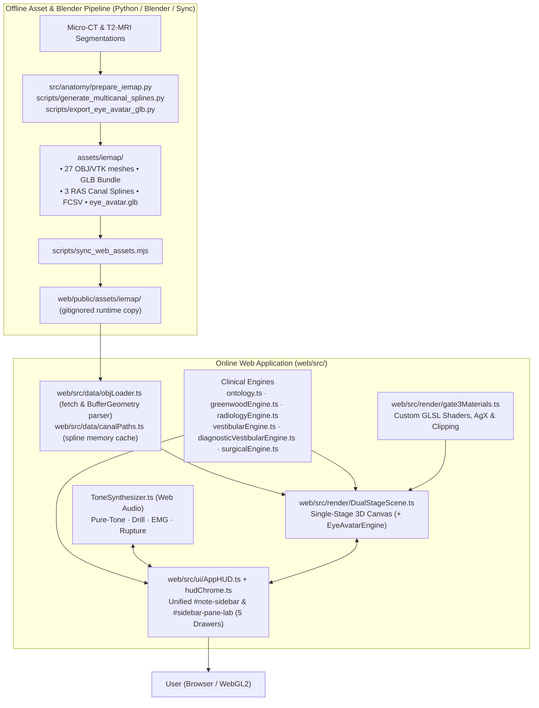
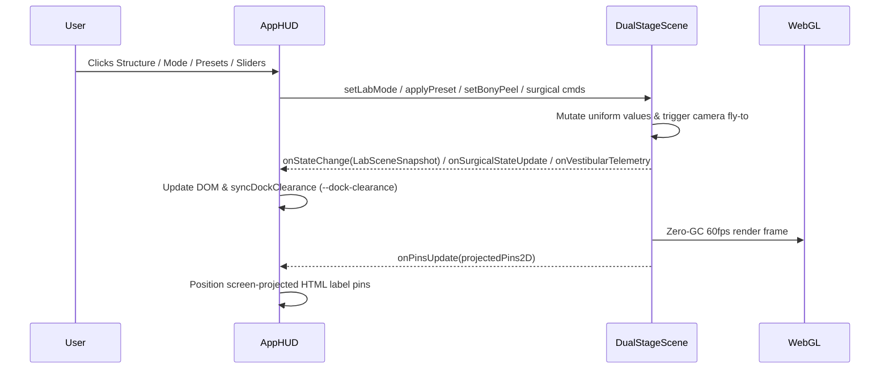

# High-Level System Architecture (`ARCHITECTURE.md`)

> **System:** Inner Ear 3D Lab  
> **Repository:** `inner-ear-3d-lab`  
> **Scope:** High-fidelity 3D Anatomical Atlas & Real-Time Biomechanical Simulation Platform across 5 Clinical Modes

---

## 1. System Overview & Architectural Topology

The system comprises two coupled pipelines bridged by canonical IE-Map v1.0.0 assets:
1. **Offline Preprocessing, Asset Sync & Video Pipeline (Python 3 / Blender 5.2.1 LTS / Node):** Ingests micro-CT / T2-MRI Otsu segmentations, normalizes coordinate frames to stereotaxic RAS, extracts 3D canal pathways, exports `eye_avatar.glb`, and syncs runtime assets from `assets/iemap/` into gitignored `web/public/assets/iemap/` via `scripts/sync_web_assets.mjs`.
2. **Client-Side Real-Time WebGL Application (Three.js / TypeScript / Vite):** A responsive, single-stage 60fps web application delivering interactive 3D exploration, procedural Web Audio synthesis, and 5 contextual clinical workbenches.



---

## 2. Layered Software Architecture

```
┌──────────────────────────────────────────────────────────────────────────────────────┐
│           LAYER 5: REACTIVE DUAL-THEME UI & HUD (AppHUD.ts & hudChrome.ts)           │
│  • 5-Mode Header Tablist + Light/Dark Theme Switcher (#settings-popover)             │
│  • Search Combobox with 3D Focus · Native <dialog id="report-dialog">                │
│  • Unified #note-sidebar (collapsed -> compact -> expanded [Note|Lab] -> wide-read)  │
│  • Contextual Bottom Dock (--dock-clearance via ResizeObserver & --dock-shift-x)     │
│  • 5 Mutually Exclusive #sidebar-pane-lab Drawers + #gyro-flyout (3-Axis Head Gyro)  │
├──────────────────────────────────────────────────────────────────────────────────────┤
│               LAYER 4: CLINICAL & PHYSIOLOGY DOMAIN ENGINES                          │
│  • 27-Part Anatomical Ontology & Innervation (ontology.ts)                           │
│  • Greenwood Auditory Frequency Engine & Sine Synthesizer (greenwoodEngine.ts)       │
│  • Stereotaxic Temporal Bone MPR & SCDS Biomarker Engine (radiologyEngine.ts)        │
│  • Multi-Canal BPPV Kinematics & Stokes/Steinhausen ODE (vestibularEngine.ts)        │
│  • Caloric Convection/Jongkees & vHIT Curthoys Engine (diagnosticVestibularEngine.ts)│
│  • Cochlear Implant / Labyrinthectomy / Neurectomy Engine (surgicalEngine.ts)        │
├──────────────────────────────────────────────────────────────────────────────────────┤
│                 LAYER 3: 3D GRAPHICS & SCENE RUNTIME                                 │
│  • DualStageScene.ts (Zero-GC render loop, AgX + RoomEnvironment IBL, alpha stage)   │
│  • Dynamic Camera Framing (setStageFraming / camera.setViewOffset for open sidebars) │
│  • Occlusion-Aware Screen-Projected HTML Pins (pre-allocated keep-out decluttering)  │
│  • EyeAvatarEngine (eyeAvatar.ts — 3-DOF Listing's Law + NIR VNG + Ring Buffer)      │
├──────────────────────────────────────────────────────────────────────────────────────┤
│                 LAYER 2: GPU SHADER PIPELINE (gate3Materials.ts)                     │
│  • Custom GLSL Vertex & Fragment Shaders + #include <tonemapping_fragment>           │
│  • Dual-Polarity Adaptive Rim & Lumen Shading (uThemeLight, uSingleSurface)          │
│  • Analytic 3D MPR Clipping Plane (uClipActive, uClipNormal, uClipConstant)          │
│  • Cochlear Tonotopy & Loss Mask (uTonotopyMode, uActiveGreenwoodX, uLossMaskActive) │
│  • Caloric Thermal Glow & Mirror Culling (uCaloricActive, uMirrored)                 │
│  • Surgical Milling, Unroofing & Breach Alarm (uSurgicalDrillActive, uCanalUnroofed) │
├──────────────────────────────────────────────────────────────────────────────────────┤
│                 LAYER 1: GEOMETRY & ASSET STORAGE LAYER                              │
│  • Canonical Source: assets/iemap/ (27 IE-Map v1.0.0 OBJs, 3 canal splines, GLB)     │
│  • Synced Runtime Copy: web/public/assets/iemap/ via scripts/sync_web_assets.mjs     │
│  • objLoader.ts parses fetched OBJ text on demand into Three.js BufferGeometry       │
│  • canalPaths.ts caches loaded 3D semicircular canal centerline splines in memory    │
└──────────────────────────────────────────────────────────────────────────────────────┘
```

---

## 3. Spatial Reference Frames & Coordinate Systems

All internal coordinates adhere to the **Right-Anterior-Superior (RAS)** stereotaxic medical standard in millimeters:

$$\mathbf{p}_{\text{RAS}} = \begin{bmatrix} x_{\text{Right}} \\ y_{\text{Anterior}} \\ z_{\text{Superior}} \end{bmatrix} \quad (\text{units: mm})$$

- **Centroid Origin:** Calibrated around `[4.5, 1.4, 0.5]` mm near the vestibule and common crus.
- **Three.js Axis Mapping:**
  - $+X \implies \text{Patient Right}$ (Lateral)
  - $+Y \implies \text{Patient Anterior}$ (Forward)
  - $+Z \implies \text{Patient Superior}$ (Cranial; `camera.up = (0, 0, 1)`)
- **Default Camera Frame (`DualStageScene.ts`):**
  - `OrbitControls` initializes on target `[4.5, 1.5, 0.2]` mm with initial camera position `[22.5, -10.5, 7.5]` mm, providing an anterolateral 3/4 view of the right labyrinth. Contralateral caloric/vHIT laterality mirrors `labyrinthRoot.scale.x = -1.0` while toggling backface winding (`uMirrored` + `FrontSide`/`BackSide`).

---

## 4. GPU Shader & Shading Architecture (`gate3Materials.ts`)

Instead of `MeshStandardMaterial`, [`gate3Materials.ts`](web/src/render/gate3Materials.ts) compiles a custom GLSL shader supporting all 5 clinical modes with in-place `.value` uniform mutation:

1. **Gate 3 Three-Point Lighting & Fresnel:** View-space key/fill/rim diffuse shading plus contour rim glow (`uRimPower`) across bony shell and membranous structures.
2. **Single-Surface Cutaway Mode (`uSingleSurface`):** Discards backfaces (`!gl_FrontFacing` or flipped during `uMirrored`) for translucent outer bony shells to avoid moiré clutter.
3. **Analytic Cross-Section Clipping (`uClipActive`, `uClipNormal`, `uClipConstant`):** Instantaneous fragment discard along Pöschl, Stenvers, Axial, and Coronal MPR planes with zero CPU geometry rebuilds.
4. **Tonotopic, Caloric & Surgical Uniforms:** Drives basilar membrane traveling waves (`uTonotopyMode`), horizontal canal thermal convection coloring (`uCaloricActive`, `uCaloricTempDiff`), high-speed bone milling luminescence (`uSurgicalDrillActive`), canal unroofing (`uCanalUnroofed`), and translocation breach warning (`uTranslocationBreach`).

---

## 5. State Management & Data Flow

The application follows a **Unidirectional Reactive Snapshot** pattern:



### Snapshot Fields (`LabSceneSnapshot`):
- `labMode`: `'anatomy' | 'hearing' | 'radiology' | 'vestibular' | 'surgical'`
- `hearingState`, `radiologyState`, `surgicalState`
- `selectedMesh`, `hoveredMesh`, `visibilityMap`, `bonyPeelPercent`, `explodePercent`
- `labelMode`, `readingDepth`, `activePresetId`, `canUndo`, `isIsolated`, loading progress flags

---

## 6. The 5-Mode Dual-Theme "Editorial Specimen" UI Architecture

Top header mode switcher (`AppHUD.ts` + `hudChrome.ts`) preserves WebGL2 camera state and specimen continuity while swapping the contextual bottom workbench dock (`#anatomy-dock-content`, `#hearing-dock-content`, `#radiology-dock-content`, `#vestibular-dock-content`, `#surgical-dock-content`) alongside unified `#note-sidebar` (`collapsed` → `compact` → `expanded` `[Note | Lab]` → `wide-read` via `<details id="further-read-details">`):

1. `Anatomy Atlas` — 27-part structural exploration, peel/explode sliders, guided camera presets, `#parts-drawer`.
2. `Hearing & Tonotopy` — Greenwood (`20 Hz–20.7 kHz`) slider, Web Audio pure-tone synthesis, `#audiogram-drawer`.
3. `Virtual Radiology` — Temporal bone MPR (Pöschl, Stenvers, Axial, Coronal), SCDS simulation, `#ct-slice-drawer`.
4. `Vestibular & VOR` — Subnav across `BPPV` (6 maneuvers + `#gyro-flyout`), `Caloric` (COWS/Alexander/Jongkees), and `vHIT` (Curthoys 40–80 ms/HIMP/SHIMP) paired with `#vor-drawer` (`EyeAvatarEngine` + strip plots).
5. `Surgical Suites` — Three procedural suites (`Cochlear Implant`, `Labyrinthectomy`, `IAC Neurectomy`), 3D CI array/drill/cleavage visualization, procedural audio, and `#surgical-drawer` (endoscopy monitor + ABR/EMG/force telemetry plot).
