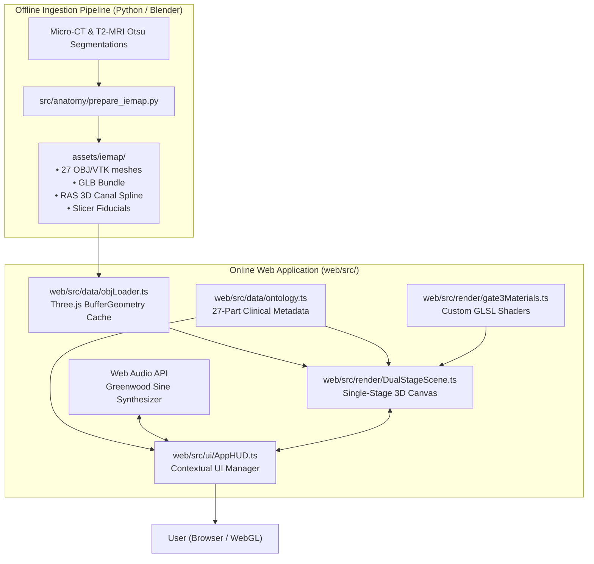
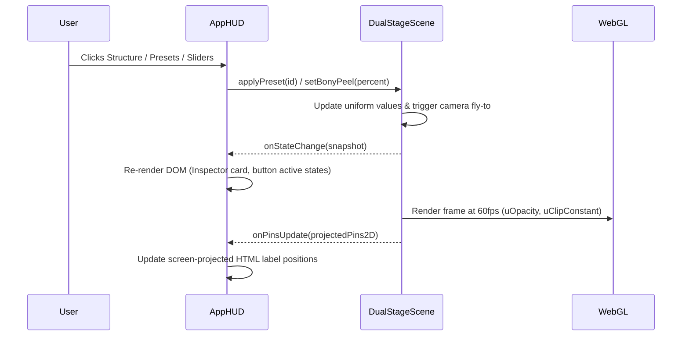

# High-Level System Architecture (`ARCHITECTURE.md`)

> **System:** Inner Ear 3D Lab  
> **Repository:** `inner-ear-3d-lab`  
> **Scope:** High-fidelity 3D Anatomical Atlas & Real-Time Biomechanical Simulation Platform

---

## 1. System Overview & Architectural Topology

The system comprises two major subsystems:
1. **Offline Preprocessing & Ingestion Pipeline (Python 3 / Blender 5.2.1 LTS):** Ingests authentic micro-CT / T2-MRI Otsu segmentations, normalizes coordinate frames to stereotaxic RAS, extracts 3D canal pathways, and generates optimized runtime assets.
2. **Client-Side Real-Time WebGL Application (Three.js / TypeScript / Vite):** A responsive, single-stage 60fps web application delivering interactive 3D exploration, procedural audio synthesis, and contextual clinical workbenches.



---

## 2. Layered Software Architecture

```
┌───────────────────────────────────────────────────────────────────────────────┐
│                     LAYER 5: REACTIVE UI & HUD (AppHUD.ts)                    │
│  • Mode Switcher (Anatomy / Hearing / Vestibular / CT Slicing)                │
│  • Search Bar with 3D Focus • Floating Inspector Card (Progressive Disclosure)│
│  • Contextual Bottom Workbench Dock • Responsive Modals & Drawers             │
├───────────────────────────────────────────────────────────────────────────────┤
│               LAYER 4: CLINICAL & PHYSIOLOGY DOMAIN ENGINES                   │
│  • 27-Part Anatomical Ontology & Innervation (ontology.ts)                    │
│  • Greenwood Auditory Frequency Engine & Sine Tone Synthesis (Web Audio)      │
│  • BPPV Semicircular Canal Kinematics & Gravity ODE Solver (epleyPhysics.ts)  │
├───────────────────────────────────────────────────────────────────────────────┤
│                 LAYER 3: 3D GRAPHICS & SCENE RUNTIME                          │
│  • DualStageScene.ts (Render loop, OrbitControls, camera fly-to interpolation) │
│  • Occlusion-Aware Screen-Projected HTML Pins (Three.js Vector3.project)      │
├───────────────────────────────────────────────────────────────────────────────┤
│                 LAYER 2: GPU SHADER PIPELINE (gate3Materials.ts)              │
│  • Custom GLSL Vertex & Fragment Shaders                                      │
│  • 3-Point Gate 3 Lighting & Fresnel Rim Glow • Single-Surface Backface Cull  │
│  • Analytic 3D Cross-Section Clipping Plane (uClipActive, uClipNormal)        │
├───────────────────────────────────────────────────────────────────────────────┤
│                 LAYER 1: GEOMETRY & ASSET STORAGE LAYER                       │
│  • 27 Authentic IE-Map v1.0.0 Meshes (RAS Stereotaxic Coordinates in mm)     │
│  • OBJ Buffers Cached in IndexedDB / Memory • Slicer FCSV Markups             │
└───────────────────────────────────────────────────────────────────────────────┘
```

---

## 3. Spatial Reference Frames & Coordinate Systems

All internal coordinates adhere to the **Right-Anterior-Superior (RAS)** stereotaxic medical standard in millimeters:

$$\mathbf{p}_{\text{RAS}} = \begin{bmatrix} x_{\text{Right}} \\ y_{\text{Anterior}} \\ z_{\text{Superior}} \end{bmatrix} \quad (\text{units: mm})$$

- **Centroid Origin:** Calibrated to `[4.5, 1.4, 0.5]` mm, centering the vestibule and common crus at the world origin `(0, 0, 0)`.
- **Three.js Mapping:**
  - $+X \implies \text{Patient Right}$ (Lateral)
  - $+Y \implies \text{Patient Anterior}$ (Forward)
  - $+Z \implies \text{Patient Superior}$ (Cranial)
- **Camera Frame:**
  - OrbitControls centers on target `(0, 0, 0)` with default initial position `(40, -50, 30)` mm, providing an elevated $3/4$ anterolateral perspective of the right labyrinth.

---

## 4. GPU Shader & Shading Architecture (`gate3Materials.ts`)

Instead of standard Three.js `MeshStandardMaterial`, the lab employs specialized GLSL shaders optimized for medical translucency:

1. **Gate 3 Three-Point Lighting**:
   - Computes key, fill, and top rim lighting directly in view space:
     $$\mathbf{I}_{\text{diffuse}} = \sum_{i=1}^3 w_i \cdot \max(0.0, \mathbf{n} \cdot \mathbf{l}_i)$$
2. **Fresnel Edge Enhancement**:
   - Highlights organic contours of delicate membranes (cupulae, ampullae):
     $$\text{Fresnel} = (1.0 - |\mathbf{n} \cdot \mathbf{v}|)^{\text{uRimPower}}$$
3. **Single-Surface Cutaway Mode (`uSingleSurface`)**:
   - For translucent outer shells (e.g. `segT2_th1.07_Otsu`), backfaces (`!gl_FrontFacing`) are discarded dynamically, eliminating visual clutter and internal mesh moiré patterns.
4. **Analytic Shader-Level Cross-Section Clipping**:
   - Avoids expensive CPU boolean mesh CSG operations.
   - Slices geometry instantaneously in fragment shader:
     ```glsl
     if (uClipActive > 0.5) {
       float clipDist = dot(vWorldPosition, uClipNormal) + uClipConstant;
       if (clipDist < 0.0) discard;
     }
     ```
   - Enables smooth 60fps scrubbing of Pöschl's, Stenvers', and orthogonal CT planes with zero memory re-allocation.

---

## 5. State Management & Data Flow

The application follows a **Unidirectional Reactive Snapshot** pattern:



### Snapshot Structure (`LabSceneSnapshot`):
- `selectedMesh: string | null`
- `hoveredMesh: string | null`
- `visibilityMap: Record<string, VisibilityState>` (`visible` | `ghost` | `hidden`)
- `bonyPeelPercent: number` ($0\text{–}100$)
- `explodePercent: number` ($0\text{–}100$)
- `labelMode: LabelDensityMode` (`off` | `key` | `all`)
- `readingDepth: ReadingDepth` (`simple` | `detailed`)
- `activePresetId: string`
- `canUndo: boolean`
- `isIsolated: boolean`

---

## 6. The "Modal Workbench" UI Architecture

To accommodate expansive clinical features without UI degradation:
- The top header acts as the **Master Mode Switcher**:
  - `🧬 Anatomy` $\to$ Structural exploration.
  - `🎧 Hearing` $\to$ Greenwood tonotopy, pure-tone synthesis, audiogram drawer.
  - `🌀 Vestibular` $\to$ Semicircular canal kinematics, BPPV maneuvers, VOR eye avatar.
  - `🩻 CT Slicing` $\to$ Multiplanar temporal bone CT clipping (Pöschl, Stenvers).
- Switching modes morphs **only the bottom dock**, preserving the full-bleed 3D canvas and maintaining muscle memory for camera navigation.
