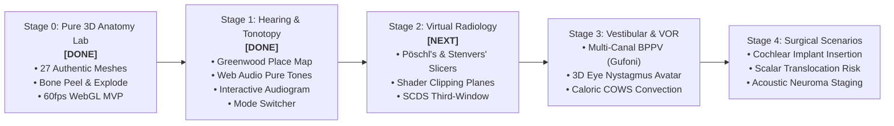

# Product Engineering Roadmap: Stage-by-Stage Implementation (`ROADMAP.md`)

> **Project:** Inner Ear 3D Lab  
> **Repository:** `radiant-darwin`  
> **Execution Strategy:** Phased modular delivery adhering to the "Modal Workbench" zero-clutter architecture.

---

## High-Level Milestone Overview

---

## Stage 0: Pure 3D Anatomy Lab MVP — ✅ COMPLETE

- [x] Ingest 27 authentic IE-Map v1.0.0 high-resolution meshes in stereotaxic RAS coordinates.
- [x] Implement single-stage Three.js WebGL canvas with 60fps OrbitControls.
- [x] Build Gate 3 custom GLSL shaders with rim lighting and backface culling (`gate3Materials.ts`).
- [x] Implement smooth camera fly-to interpolation for part framing.
- [x] Implement `Outer Bone Shell` translucency peel slider ($0\text{–}100\%$) and `Separate Parts` radial explode slider ($0\text{–}100\%$).
- [x] Implement 27-part clinical ontology (`ontology.ts`) with Latin names, innervation, fluid spaces, and clinical pearls.
- [x] Implement search bar with keyboard navigation and occlusion-aware screen-projected HTML pins.
- [x] Perform bundle optimization ($18\text{ kB}$ CSS, $582\text{ kB}$ JS) and multi-viewport verification.

---

## Stage 1: Audio-Visual Tonotopy Engine & Hearing Lab — ✅ COMPLETE

### Objective
Transform the static cochlea into an interactive frequency analyzer driven by the Greenwood function and real-time Web Audio API pure-tone synthesis, complete with an interactive clinical audiogram drawer.

### Task Breakdown
- [x] **Step 1.1: Web Audio Pure-Tone Synthesizer (`web/src/audio/ToneSynthesizer.ts`)**:
  - Implement a shared browser `AudioContext` with lazy user-gesture initialization.
  - Implement dynamic sine-wave generation (`OscillatorNode`, `GainNode`) with exponential attack/decay envelope ($50\text{ ms}$) to prevent speaker clicking.
  - Provide continuous pitch gliding for frequency scrubbing ($35\text{ ms}$ time constant).
  - Add safety dynamics compressor limiter ($-4\text{ dB}$ threshold, $12:1$ ratio).
- [x] **Step 1.2: Greenwood Place-Frequency Engine (`web/src/data/greenwoodEngine.ts`)**:
  - Implement the Donald D. Greenwood formula: $F(x) = 165.4 \cdot (10^{2.1 \cdot x} - 0.88)$ and inverse $x(F)$.
  - 100-knot 3D RAS spline table ($28.79\text{ mm}$ apex to base).
  - Ultra-fast continuous orthogonal segment projection ($<5\text{ ms}$ for 8k verts, zero memory leak / OOM).
  - Barycentric face vertex interpolation for raycast picking without inter-turn aliasing.
- [x] **Step 1.3: Hearing Mode Shading & Spectral Gradient in `DualStageScene.ts`**:
  - Add `hearingLab` mode support to `DualStageScene`.
  - In Hearing Mode: Automatically ghost the vestibular system (canals, ampullae, vestibule) to $15\%$ opacity to direct visual focus to the cochlea.
  - Render a continuous 7-stop perceptual rainbow spectral gradient along the cochlear coil (Red $\approx 20\text{ kHz}$ base $\to$ Gold $\approx 4\text{ kHz}$ $\to$ Green $\approx 1\text{ kHz}$ $\to$ Cyan $\approx 500\text{ Hz}$ $\to$ Violet $\approx 20\text{ Hz}$ apex).
  - Add animated traveling wave pulse ripple on tone trigger (`uWavePhase`).
- [x] **Step 1.4: Top Header Mode Switcher (`AppHUD.ts`)**:
  - Add the clean segmented mode pill in the top header: `[ 🏛️ Anatomy Atlas ] [ 🎵 Hearing & Tonotopy ]`.
  - Maintain desktop, tablet, and mobile responsiveness without crowding the search bar.
- [x] **Step 1.5: Contextual Bottom Dock for Hearing Mode**:
  - Morph the bottom bar when in Hearing Mode:
    - Logarithmic Frequency Slider ($20\text{ Hz}\to 20{,}000\text{ Hz}$).
    - `Play Tone ▶` toggle button and live readout (`4000 Hz · 4 kHz Notch (19.2 mm)`).
    - Audiometric octave jump chips (`125`, `250`, `500`, `1k`, `2k`, `4k`, `8k`).
- [x] **Step 1.6: Interactive Clinical Audiogram Drawer (`AudiogramDrawer.ts`)**:
  - Collapsible `[ 📊 Audiogram ▾ ]` drawer sliding up over the bottom-right corner.
  - Interactive $125\text{ Hz}\to 8{,}000\text{ Hz}$ / $-10\text{ dB}\to 120\text{ dB HL}$ standard clinical grid with right-ear red circle $\bigcirc$ markers and Speech Banana overlay.
  - 4 Clinical Presets: `Normal Hearing`, `Presbycusis (High Loss)`, `4 kHz Noise Notch`, `Ménière's (Low Loss)`.
  - Bi-directional 3D linking: selecting presets maps damaged hair-cell zones in crimson on the 3D cochlea.
  - Drawer mutual exclusivity: opening Audiogram closes Parts Drawer and vice versa.
- [x] **Step 1.7: Fluid Compartment & Voltage Badge in Inspector**:
  - Display Scala Media (Endolymph $+80\text{ mV}$, high $\text{K}^+$) vs. Scala Tympani/Vestibuli (Perilymph $0\text{ mV}$, high $\text{Na}^+$).
  - Display $150\text{ mV}$ electrical driving force badge.
- [x] **Step 1.8: Build & QA Verification**:
  - Zero TypeScript errors (`npm run build`).
  - Automated deep unit tests: `scripts/test_hearing_engine.js` (100% pass across 7 suites).
  - Headless Chrome CDP verification: `scripts/verify_mvp_cdp.js` (100% pass across 4 viewports with 0 errors).

---

## Stage 2: Virtual Temporal Bone Radiology & SCDS Third-Window

### Objective
Enable medical students and ENT residents to master multiplanar CT/MRI cross-sections of the petrous temporal bone directly against the 3D anatomical model.

### Task Breakdown
- [ ] **Step 2.1: Analytic Shader Slicing Integration**:
  - Expose the existing GLSL clipping plane uniforms in `gate3Materials.ts` to `DualStageScene.ts`.
- [ ] **Step 2.2: Clinical Slicing Plane Presets**:
  - **Pöschl's Plane**: Oblique sagittal parallel to the superior semicircular canal (gold standard for SSCD).
  - **Stenvers' Plane**: Oblique coronal perpendicular to Pöschl's plane (profiles canal arch & vestibular aqueduct).
  - **True Axial Plane**: Horizontal canal signet ring and internal auditory canal (IAC).
  - **True Coronal Plane**: Cochlear modiolus and round window niche.
- [ ] **Step 2.3: Contextual CT Bottom Dock & Depth Slider**:
  - Single depth slider scrubbing through the temporal bone with live millimeter readout.
- [ ] **Step 2.4: Synchronized 2D CT Slice Card**:
  - Side-by-side or docked mini-CT display showing corresponding authentic HRCT slices.
- [ ] **Step 2.5: Superior Canal Dehiscence (SCDS) Defect Toggle**:
  - Interactive bone defect toggle displaying acoustic/hydraulic sound shunting, Tullio phenomenon, and autophony.

---

## Stage 3: Multi-Canal Vestibular Dynamics & VOR Eye Avatar

### Objective
Expand vestibular simulation beyond the posterior canal to encompass all 3 semicircular canals, complex BPPV maneuvers, caloric irrigation, and a synchronized 3D eye avatar demonstrating the vestibulo-ocular reflex.

### Task Breakdown
- [ ] **Step 3.1: Multi-Canal BPPV & Maneuver Presets**:
  - Horizontal Canal BPPV: Geotropic (canalithiasis) and Apogeotropic (cupulolithiasis) with Gufoni maneuver and Lempert 360° Barbecue roll.
  - Anterior Canal BPPV with Yacovino maneuver.
- [ ] **Step 3.2: Synchronized 3D Dual-Eye Avatar**:
  - Inset 3D eye model showing compensatory slow-phase gaze drift and fast-phase resetting saccades.
- [ ] **Step 3.3: Caloric Testing Simulator (COWS Rule)**:
  - Simulate warm ($44^\circ\text{C}$) vs. cold ($30^\circ\text{C}$) convective endolymph flow and Jongkees canal paresis calculation.
- [ ] **Step 3.4: Video Head Impulse Test (vHIT)**:
  - High-acceleration head thrust simulation across horizontal, RALP, and LARP canal planes with covert/overt saccade detection.

---

## Stage 4: Otologic Surgical Scenarios & Procedural Pathology

### Objective
Deliver specialized otologic surgical planning tools for surgical residents and otologists.

### Task Breakdown
- [ ] **Step 4.1: Cochlear Implant (CI) Scala Tympani Insertion**:
  - Simulated electrode array insertion through Round Window vs. Cochleostomy approaches.
  - Real-time angular insertion depth ($0^\circ \to 360^\circ \to 540^\circ$) and Greenwood frequency coverage readout.
- [ ] **Step 4.2: Scalar Translocation Warning System**:
  - Collision detection flagging basilar membrane rupture into the scala vestibuli.
- [ ] **Step 4.3: Vestibular Schwannoma (Acoustic Neuroma) Koos Staging**:
  - Tumor growth slider (Stages I–IV) demonstrating internal auditory canal compression of CN VII and CN VIII.
