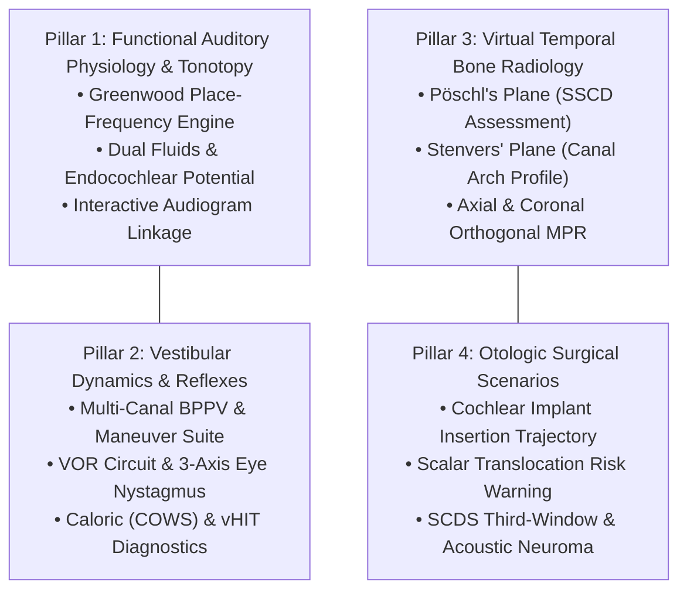
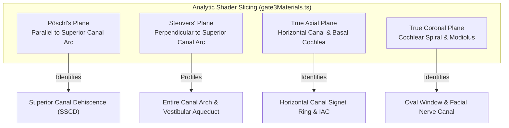

# Clinical & Pedagogical Foundations: The 4 Expansion Pillars

> **Project:** Inner Ear 3D Lab  
> **Target Audience:** Medical Students, ENT Residents, Neurology Fellows, Audiologists  
> **Source Material:** Authentic IE-Map v1.0.0 High-Resolution Dataset, Clinical Otology & Neurotology Curricula

---

## 1. Executive Summary

The inner ear is an engineering masterpiece of fluid biomechanics, micro-electrophysiology, and 3D spatial orientation. However, because it is encased within the petrous temporal bone (the densest bone in the human body), it cannot be directly visualized in living patients.

To transform our pure 3D anatomy viewer into an indispensable tool for medical students and specialists, the platform is anchored upon **Four Clinical Pillars**:

---

## 2. Pillar 1: Functional Auditory Physiology & Tonotopy

### 2.1 The Greenwood Place-Frequency Map
The human basilar membrane acts as a physical Fourier analyzer. High frequencies cause maximal displacement at the narrow, stiff base near the oval window; low frequencies travel the length of the cochlea to cause maximal displacement at the broad, compliant apex.

The relationship is governed by the **Donald D. Greenwood Function (1990)**:

$$F(x) = A \cdot \left(10^{a \cdot x} - k\right)$$

For the **human cochlea**:
- $A = 165.4\text{ Hz}$ (species-specific frequency scaling constant)
- $a = 2.1$ (when $x$ is normalized from $0.0$ at the apex to $1.0$ at the base)
- $k = 0.88$ (integration constant setting the lower limit at $\approx 20\text{ Hz}$)

At normalized positions:
- **Apex ($x = 0.0$):** $F = 165.4 \cdot (10^0 - 0.88) = 19.85\text{ Hz} \approx 20\text{ Hz}$
- **Mid-Turn ($x = 0.5$):** $F = 165.4 \cdot (10^{1.05} - 0.88) \approx 1,710\text{ Hz}$ (Critical vowel formant zone)
- **4 kHz Notch ($x \approx 0.68$):** $F \approx 4,000\text{ Hz}$ (Noise-induced trauma zone, $8\text{–}10\text{ mm}$ from base)
- **Base ($x = 1.0$):** $F = 165.4 \cdot (10^{2.1} - 0.88) \approx 20{,}678\text{ Hz} \approx 20.7\text{ kHz}$

### 2.2 Dual Fluid Compartments & Electrophysiology
Students frequently memorize but fail to understand the biological battery driving hearing:
1. **Endolymph (Scala Media, Ducts, Saccules):**
   - Maintained by the vascularized *stria vascularis*.
   - Composition: High $\text{K}^+$ ($140\text{–}160\text{ mM}$), very low $\text{Na}^+$ ($1\text{–}2\text{ mM}$).
   - Potential: $+80\text{ mV}$ (the **Endocochlear Potential**, EP).
2. **Perilymph (Scala Tympani, Scala Vestibuli):**
   - Communicates with CSF via the cochlear aqueduct.
   - Composition: High $\text{Na}^+$ ($140\text{–}150\text{ mM}$), low $\text{K}^+$ ($3\text{–}5\text{ mM}$).
   - Potential: $0\text{ mV}$.
3. **Mechanotransduction Driving Force:**
   - Hair cell intracellular potential is $-70\text{ mV}$.
   - The effective electrical gradient driving $\text{K}^+$ through stereocilia tip-link MET channels into the hair cell is $150\text{ mV}$ ($+80\text{ mV} - (-70\text{ mV})$), one of the steepest ionic driving forces in human biology.

### 2.3 Interactive Audiogram Correlation
Linking audiometric threshold shifts ($\text{dB HL}$) to the 3D basilar membrane:
- **Presbycusis:** Symmetrical high-frequency rolloff $\to$ base turn outer hair cell death.
- **Acoustic Trauma:** Discrete notch at $4{,}000\text{ Hz}$ with recovery at $8{,}000\text{ Hz}$.
- **Ménière's Disease (Early):** Low-frequency threshold elevation ($250\text{–}1{,}000\text{ Hz}$) at the apex due to endolymphatic hydrops pressure.

---

## 3. Pillar 2: 3D Vestibular Dynamics, Reflexes & Pathology

### 3.1 Semicircular Canal Kinematics & Ewald's Laws
The 3 semicircular canals on each side operate as coplanar push-pull pairs:
- **Horizontal Canals:** Right Horizontal $\leftrightarrow$ Left Horizontal (inclined $30^\circ$ anterosuperiorly relative to Reid's baseline).
- **Vertical Pairs:**
  - **RALP:** Right Anterior $\leftrightarrow$ Left Posterior (parallel planes, $45^\circ$ to sagittal).
  - **LARP:** Left Anterior $\leftrightarrow$ Right Posterior.

**Ewald's Laws of Vestibular Function:**
1. **1st Law:** Eye and head movements occur in the plane of the canal being stimulated.
2. **2nd Law (Horizontal Canal):** Ampullopetal endolymph flow (toward ampulla) causes **excitation** (depolarization); ampullofugal flow causes **inhibition**.
3. **3rd Law (Vertical Canals):** Ampullofugal flow causes **excitation**; ampullopetal flow causes **inhibition** (reversed compared to horizontal).

### 3.2 Comprehensive Multi-Canal BPPV & Maneuver Suite
BPPV occurs when calcium carbonate otoconia detach from the utricular macula:
- **Posterior Canal BPPV (85–90%):**
  - Diagnosis: Dix-Hallpike test produces paroxysmal upbeating, torsional nystagmus (top poles of eyes beat toward the dependent affected ear).
  - Treatment: Epley maneuver (canalith repositioning procedure) or Semont maneuver.
- **Horizontal Canal BPPV (10–15%):**
  - Diagnosis: Supine roll test.
  - *Geotropic Variant (Canalithiasis)*: Nystagmus beats toward floor; stronger on the affected side. Treatment: Gufoni maneuver (lying on healthy side) or Lempert 360° Barbecue roll.
  - *Apogeotropic Variant (Cupulolithiasis)*: Debris adherent to cupula; nystagmus beats toward ceiling; stronger on the unaffected side. Treatment: Modified Gufoni (lying on affected side).
- **Anterior Canal BPPV (<2%):**
  - Diagnosis: Downbeating nystagmus on Dix-Hallpike. Treatment: Yacovino maneuver.

### 3.3 Diagnostic Vestibular Testing Simulations
- **Caloric Irrigation Simulator (COWS Rule):**
  - Irrigating external auditory canal with cold ($30^\circ\text{C}$) or warm ($44^\circ\text{C}$) water creates endolymph temperature gradients.
  - Convective flow in the horizontal canal: Warm water makes endolymph less dense $\to$ rises $\to$ ampullopetal flow $\to$ excitation $\to$ nystagmus beats toward **Same** ear. Cold water causes sinking $\to$ ampullofugal flow $\to$ inhibition $\to$ nystagmus beats toward **Opposite** ear (**C**old **O**pposite, **W**arm **S**ame).
  - Calculate Canal Paresis using **Jongkees Formula**:
    $$CP = \frac{(R_{warm} + R_{cold}) - (L_{warm} + L_{cold})}{R_{warm} + R_{cold} + L_{warm} + L_{cold}} \times 100\%$$
- **Video Head Impulse Test (vHIT):**
  - Simulates high-acceleration, passive, unpredictable head thrusts.
  - Normal VOR gain: $0.8\text{–}1.2$.
  - Unilateral vestibular deficit (e.g. vestibular neuritis): Depressed VOR gain accompanied by **overt saccades** (visible after head stop) or **covert saccades** (occurring during head rotation).

---

## 4. Pillar 3: Virtual Temporal Bone Radiology (HRCT & MRI)

Because the otic capsule is dense cortical bone, High-Resolution CT (slice thickness $\le 0.625\text{ mm}$, bone algorithm) requires specialized oblique multiplanar reformats (MPRs).

### 4.1 Pöschl's Plane (Oblique Sagittal)
- **Orientation:** Aligned parallel to the long axis of the petrous pyramid and the ring of the superior semicircular canal (SSC).
- **Radiological Landmark:** SSC appears as a complete, smooth osseous ring ("halo").
- **Clinical Gold Standard:** Diagnosis of **Superior Semicircular Canal Dehiscence Syndrome (SSCD)**. Absence of bone overlying the superior canal arc facing the middle cranial fossa can be reliably measured without volume averaging.

### 4.2 Stenvers' Plane (Oblique Coronal)
- **Orientation:** Orthogonal ($90^\circ$) to Pöschl's plane, running perpendicular to the superior canal arc.
- **Radiological Landmark:** Cross-sectional profile through both the anterior and posterior limbs of the SSC.
- **Clinical Utility:** Cross-verification of SSCD, evaluation of the vestibular aqueduct (checking for Enlarged Vestibular Aqueduct syndrome, EVA $>1.5\text{ mm}$ at midpoint), and visualization of the round window niche for cochlear implant planning.

---

## 5. Pillar 4: Otologic Surgical Scenarios & Procedural Pathology

### 5.1 Cochlear Implant (CI) Electrode Insertion
- **Surgical Trajectory:**
  - Trans-mastoid posterior tympanotomy (facial recess approach, bounded by the facial nerve trunk medially and the chorda tympani laterally).
  - Entry via **Round Window (RW)** membrane or anteroinferior cochleostomy.
- **Critical Intra-Cochlear Anatomy:**
  - The electrode must remain strictly within the **Scala Tympani (ST)**.
  - Angular insertion depth: $360^\circ$ covers frequencies down to $\sim 1\text{ kHz}$; $540^\circ\text{–}650^\circ$ covers apical low frequencies.
- **Surgical Complication: Scalar Translocation:**
  - If the array tip strikes the outer lateral wall or modiolus at a steep angle, it buckles and ruptures through the basilar membrane/spiral lamina into the **Scala Vestibuli (SV)**.
  - Consequence: Immediate destruction of remaining residual acoustic hair cells and spiral ganglion trauma. Our 3D simulator detects collision vectors and flags translocation risk.

### 5.2 Superior Semicircular Canal Dehiscence Syndrome (SCDS)
- **Third-Window Biomechanics:**
  - A hole in the bone overlying the superior canal creates an abnormal third mobile window in the inner ear (in addition to the oval and round windows).
  - Acoustic and hydraulic energy leaks into the cranial cavity.
  - **Clinical Triad**:
    1. *Tullio Phenomenon*: Vertigo and nystagmus induced by loud sounds.
    2. *Hennebert's Sign*: Vertigo induced by pressure changes in the external ear canal.
    3. *Autophony*: Hypersensitivity to bone-conducted internal sounds (hearing one's own voice, footsteps, or eye movements).

### 5.3 Vestibular Schwannoma (Acoustic Neuroma)
- **Anatomical Origin:** Benign Schwann cell tumor originating at the glial-Schwann cell junction (Obersteiner-Redlich zone) of the superior or inferior vestibular nerve inside the Internal Auditory Canal (IAC).
- **Koos Grading Staging:**
  - *Stage I*: Purely intracanalicular ($<1\text{ cm}$).
  - *Stage II*: Protruding into cerebellopontine angle (CPA) without brainstem contact ($1\text{–}2\text{ cm}$).
  - *Stage III*: Filling the CPA and touching the brainstem without deformation ($2\text{–}3\text{ cm}$).
  - *Stage IV*: Massive tumor compressing the brainstem, 4th ventricle, and cranial nerves ($>3\text{ cm}$).
