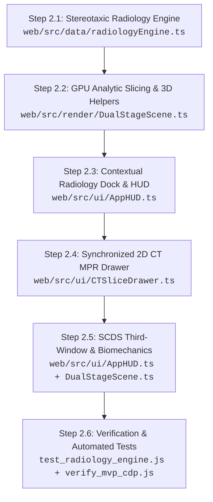

# Stage 2 Engineering Plan: Virtual Temporal Bone Radiology & SCDS Third-Window

> **Project:** Inner Ear 3D Lab (Gate 3 Medaium)  
> **Status:** Detailed Implementation Plan (`/plan /boost`)  
> **Predecessor:** Stage 1 (Audio-Visual Tonotopy Engine & Hearing Lab) — ✅ COMPLETE & VERIFIED  
> **Target Audience:** Medical Students, Otolaryngology (ENT) Residents, Neuroradiology Fellows, Audiologists  
> **Architectural Standard:** "Modal Workbench" Zero-Clutter Architecture (3D Stage $\ge 85\%$ Screen Area)

---

## 1. Executive Summary & Clinical Rationale

In otolaryngology and neurotology, the petrous temporal bone is regarded as the most anatomically complex structure in the human body. Because the otic capsule consists of exceptionally dense cortical bone ($>2{,}000\text{ Hounsfield Units}$), standard orthogonal axial and coronal CT imaging fails to profile the semicircular canals without severe partial-volume averaging artifacts.

To properly evaluate canal pathology—most notably **Superior Semicircular Canal Dehiscence Syndrome (SSCD / Minor's Syndrome)**—radiologists and otologists rely on specialized oblique multiplanar reformations (MPRs):
1. **Pöschl's Plane (Oblique Sagittal):** Aligned parallel to the ring of the superior semicircular canal (SSC). Profiles the canal as a continuous osseous "halo" and serves as the clinical gold standard for measuring bone dehiscence.
2. **Stenvers' Plane (Oblique Coronal):** Aligned strictly perpendicular ($90^\circ$) to Pöschl's plane. Profiles the anterior and posterior limbs of the SSC end-on, the vestibular aqueduct, and the round window niche for cochlear implant trajectory planning.
3. **True Axial (Transverse):** Profiles the horizontal (lateral) canal "signet ring sign", basal cochlear turn, and internal auditory canal (IAC).
4. **True Coronal (Frontal):** Profiles the 2.5 spiral turns of the cochlea, the modiolus, the promontory, and the tympanic segment of the facial nerve (CN VII).

**Stage 2 Deliverables:**
- Expose the $O(1)$ GPU fragment shader clipping plane uniforms in `web/src/render/gate3Materials.ts` through `DualStageScene.ts`.
- Build the **Stereotaxic Radiology Engine (`web/src/data/radiologyEngine.ts`)** with authentic RAS plane equations derived from authentic IE-Map v1.0.0 fiducials and mesh PCA.
- Integrate the 3rd navigation mode in the Top Header Switcher: `[ 🩻 Virtual Radiology ]`.
- Morph the Contextual Bottom Bar into the **Radiology Workbench**: 4 plane selection chips, continuous high-precision depth scrubber ($-8.0\text{ to }+8.0\text{ mm}$), live anatomical landmark readout, cut-normal flip toggle, and 3D plane guide helper.
- Build the **Synchronized 2D CT MPR Slice Drawer (`web/src/ui/CTSliceDrawer.ts`)**: interactive bone-window ($W:4000, L:+700$) cross-section viewer with anatomical crosshairs, caliper measurement, directional orientation markers, and scale bar.
- Implement the **Superior Canal Dehiscence (SCDS) Defect Toggle & Third-Window Biomechanics Engine**: interactive $1.5\text{ mm}$ apical bone defect, sound shunting visualization, and clinical triad breakdown (Tullio phenomenon, Hennebert's sign, autophony).
- Verification: Unit test suite (`scripts/test_radiology_engine.js`), headless Chrome multi-viewport testing (`scripts/verify_mvp_cdp.js`), and 0 TypeScript build errors.

---

## 2. Mathematical & Stereotaxic Coordinate Foundations

All calculations are anchored in the Right-Anterior-Superior (RAS) stereotaxic millimeter coordinate system:
- $+X$: Patient Right (Lateral) $\leftrightarrow$ $-X$: Patient Left (Medial)
- $+Y$: Patient Anterior (Front) $\leftrightarrow$ $-Y$: Patient Posterior (Back)
- $+Z$: Patient Superior (Cranial) $\leftrightarrow$ $-Z$: Patient Inferior (Caudal)

### 2.1 Authentic Anatomical Reference Anchors
From the authentic IE-Map v1.0.0 high-field MRI segmentation:
- **Otic Capsule Centroid ($C$):** $[4.40, 2.01, -0.31]\text{ mm}$
- **Superior Semicircular Canal Apex (`SSC_ant_apex`):** $[3.85, 0.45, 4.30]\text{ mm}$
- **Superior Canal Common Crus Junction (`SSC_ant_cc_junction`):** $[4.20, -2.20, 2.00]\text{ mm}$
- **Lateral Semicircular Canal Apex (`SSC_lat_apex`):** $[6.85, 0.20, 0.65]\text{ mm}$
- **Cochlear Modiolus Centroid (`mesh_david_cochlea`):** $[1.77, 6.38, -2.96]\text{ mm}$

### 2.2 SVD / PCA Plane Normal Derivations
Eigenvalue decomposition of the superior semicircular canal surface mesh (`ls_Hsapiens_Sa.obj`, 4,964 vertices) yields the following principal axes:
- **Major In-Plane Axis (Anteromedial-to-Posterolateral):** $\mathbf{u}_1 = [0.576, 0.816, -0.055]$ ($\lambda_1 = 38{,}559$)
- **Vertical In-Plane Axis (Superior-to-Inferior Arc):** $\mathbf{u}_2 = [-0.077, -0.012, -0.997]$ ($\lambda_2 = 12{,}878$)
- **Canal Plane Normal (Perpendicular to Canal Disc):** $\mathbf{n}_{\text{poschl}} = [0.814, -0.578, -0.056]$ ($\lambda_3 = 602$)

Because $\lambda_3 \ll \lambda_1, \lambda_2$, the superior canal is remarkably co-planar in 3D space, tilted approximately $35.4^\circ$ relative to the sagittal plane ($X$-axis).

### 2.3 The 4 Canonical Clinical Slicing Planes & Orthonormal Reference Table

To guarantee strict right-handed spatial geometry without inversion or partial volume distortion, every plane defines an orthonormal triad $(\mathbf{u}, \mathbf{v}, \mathbf{n})$ where $\mathbf{u} \times \mathbf{v} = \mathbf{n}$, $\|\mathbf{u}\| = \|\mathbf{v}\| = \|\mathbf{n}\| = 1.0$, and reference centroid $C = [4.40, 2.01, -0.31]\text{ mm}$:

| Plane Preset | Normal $\mathbf{n}$ (RAS) | In-Plane X $\mathbf{u}$ (Horiz) | In-Plane Y $\mathbf{v}$ (Vert) | Depth Range $\Delta s$ (mm) | Default $s$ (mm) | Camera Pos RAS (Eye) | Camera Up RAS | Orientation Tokens (Top / Bottom / Left / Right) | Clinical Target |
| :--- | :--- | :--- | :--- | :--- | :--- | :--- | :--- | :--- | :--- |
| **1. Pöschl's Plane** (Oblique Sagittal) | $[0.814, -0.578, -0.056]$ | $[0.576, 0.816, -0.055]$ | $[0.077, 0.013, 0.997]$ | $[-9.0, +9.0]$ | $+1.2$ | $[-20.02, 19.35, 1.37]$ | $[0.08, 0.01, 1.00]$ | `S` / `I` / `AS` / `PI` | SSC "Halo" Ring, Middle Fossa Dura Floor, SSCD Bone Defect |
| **2. Stenvers' Plane** (Oblique Coronal) | $[0.576, 0.816, -0.055]$ | $[-0.814, 0.578, 0.056]$ | $[0.077, 0.013, 0.997]$ | $[-6.0, +6.0]$ | $0.0$ | $[-12.88, -22.47, 1.34]$ | $[0.08, 0.01, 1.00]$ | `S` / `I` / `PL` / `AM` | SSC Anterior/Posterior Limbs cross-section, IAC, Vestibular Aqueduct |
| **3. True Axial Plane** (Transverse MPR) | $[0.000, 0.000, 1.000]$ | $[1.000, 0.000, 0.000]$ | $[0.000, 1.000, 0.000]$ | $[-7.0, +9.0]$ | $+1.0$ | $[4.40, 2.01, -30.31]$ | $[0.00, 1.00, 0.00]$ | `A` / `P` / `M` / `L` | Lateral Canal "Signet Ring", Basal Cochlear Turn, IAC Porus/Fundus |
| **4. True Coronal Plane** (Frontal MPR) | $[0.000, 1.000, 0.000]$ | $[-1.000, 0.000, 0.000]$ | $[0.000, 0.000, 1.000]$ | $[-8.5, +7.5]$ | $0.0$ | $[4.40, -27.99, -0.31]$ | $[0.00, 0.00, 1.00]$ | `S` / `I` / `L` / `M` | Cochlear Modiolus (2.5 turns), Promontory, Oval Window, Mastoid CN VII |

*Note on Coronal Handedness & Orientation:* In the Coronal plane, setting $\mathbf{u} = [-1, 0, 0]$ (Medial) with $\mathbf{v} = [0, 0, 1]$ (Superior) preserves a true right-handed triad $(\mathbf{u} \times \mathbf{v} = \mathbf{n} = [0, 1, 0])$ and matches radiological convention where the patient's right ear (Lateral) appears on the left side of the screen (`L`), and Medial on the right (`M`).
*Note on Normalization:* All normal and in-plane vectors must be strictly unit-normalized upon loading ($\|\mathbf{n}\| = 1.0$) to avoid floating-point metric drift in shader clipping constants.

### 2.4 GPU Clipping Equation & Uniform Translation
The fragment shader in `web/src/render/gate3Materials.ts` enforces the half-space test:
$$\text{clipDist} = \mathbf{P}_{\text{world}} \cdot \mathbf{u}_{\text{ClipNormal}} + u_{\text{ClipConstant}}$$
$$\text{If } \text{clipDist} < 0.0 \implies \text{discard;}$$

For an arbitrary plane passing through point $\mathbf{P}_0 = C + s \cdot \mathbf{n}$ with unit normal $\mathbf{n}$:
$$(\mathbf{P} - \mathbf{P}_0) \cdot \mathbf{n} \ge 0 \implies \mathbf{P} \cdot \mathbf{n} - \mathbf{P}_0 \cdot \mathbf{n} \ge 0$$
Therefore:
$$\mathbf{u}_{\text{ClipNormal}} = \mathbf{n}$$
$$u_{\text{ClipConstant}} = -(\mathbf{P}_0 \cdot \mathbf{n}) = -(C \cdot \mathbf{n} + s)$$

When the user toggles **Invert Cut Direction (`flipNormal: true`)**:
$$\mathbf{u}_{\text{ClipNormal}} = -\mathbf{n}$$
$$u_{\text{ClipConstant}} = +(C \cdot \mathbf{n} + s)$$

This allows seamless, bi-directional scrubbing without mesh reconstruction or memory re-allocation.

---

## 3. UI/UX Architecture: The Radiology Workbench

In adherence to [`docs/UI_DESIGN_SPEC.md`](UI_DESIGN_SPEC.md), Stage 2 introduces **Mode 3 (`🩻 Virtual Radiology`)** without adding persistent sidebars or reducing the 3D canvas below $85\%$ screen area.

```
┌────────────────────────────────────────────────────────────────────────────────────────┐
│ ZONE 1: TOP HEADER                                                                     │
│ [IE-MAP 3D] Inner Ear Lab    [ 🏛️ Anatomy │ 🎵 Hearing │ 🩻 Virtual Radiology ]    [⚙️] │
├────────────────────────────────────────────────────────────────────────────────────────┤
│ ZONE 2: FULL-BLEED 3D STAGE (Three.js WebGL 60fps)                                     │
│                                                                                        │
│   ┌──────────────────────────┐             [ 3D Bony Otic Capsule ]                    │
│   │ ZONE 3: FLOATING         │             [ Analytic Cut Plane Highlight ]            │
│   │ INSPECTOR CARD           │             [ 📐 Cyan Technical Grid Quad ]             │
│   │ (SCDS Third-Window Pearls│                                                         │
│   │ & Tullio / Hennebert)    │                                                         │
│   └──────────────────────────┘                                ┌──────────────────────┐ │
│                                                               │ ZONE 5: DOCKED       │ │
│                                                               │ 2D CT MPR CARD       │ │
│                                                               │ (Bone Window 4000/700│ │
│                                                               │ Landmark Crosshair)  │ │
│                                                               └──────────────────────┘ │
├────────────────────────────────────────────────────────────────────────────────────────┤
│ ZONE 4: CONTEXTUAL RADIOLOGY WORKBENCH DOCK                                            │
│ Plane: [ Pöschl's (SSCD) ] [ Stenvers' (Arch) ] [ True Axial ] [ True Coronal ]        │
│ Depth: [◀] [─────────●────────] +1.2 mm (SSC Arc Roof) [▶]   [⇄ Flip] [⚡ SCDS] [🩻 CT▾] │
└────────────────────────────────────────────────────────────────────────────────────────┘
```

### 3.1 Top Header Mode Switcher
The header navigation expands from 2 to 3 tabs:
```html
<nav class="mode-switcher" role="tablist" aria-label="Lab Modes">
  <button class="mode-pill" id="mode-anatomy-btn">🏛️ Anatomy Atlas</button>
  <button class="mode-pill" id="mode-hearing-btn">🎵 Hearing &amp; Tonotopy</button>
  <button class="mode-pill" id="mode-radiology-btn">🩻 Virtual Radiology</button>
</nav>
```
Responsive breakpoints:
- Desktop ($\ge 1200\text{px}$): Full text labels (`🏛️ Anatomy Atlas`, `🎵 Hearing & Tonotopy`, `🩻 Virtual Radiology`).
- Tablet ($768\text{px} - 1199\text{px}$): Compact labels (`🏛️ Atlas`, `🎵 Hearing`, `🩻 Radiology`).
- Mobile ($< 768\text{px}$): Icon-focused horizontal segmented pill with `44px` touch targets.

### 3.2 Contextual Radiology Workbench Dock (`radiology-dock-content`)
When `labMode === 'radiology'`, the bottom dock morphs into a high-density, touch-friendly control strip:
1. **Plane Selection Segmented Chips:**
   - `[ 📐 Pöschl (SSCD) ]`: Activates oblique sagittal plane parallel to SSC.
   - `[ 📐 Stenvers (Arch) ]`: Activates oblique coronal plane perpendicular to SSC.
   - `[ 📐 Axial ]`: Activates transverse MPR.
   - `[ 📐 Coronal ]`: Activates frontal MPR.
2. **High-Precision Slice Depth Scrubber:**
   - HTML range slider with $0.1\text{ mm}$ step increments dynamically bounded to the active plane (Pöschl $[-9.0, +9.0]$, Stenvers $[-6.0, +6.0]$, Axial $[-7.0, +9.0]$, Coronal $[-8.5, +7.5]\text{ mm}$).
   - Live clinical readout badge: e.g., `+1.2 mm · Superior Canal Osseous Halo (SSCD Gold Standard)`.
   - Step bump buttons `[◀ -0.5mm]` and `[▶ +0.5mm]` for fine single-slice stepping.
3. **Action & Visualization Toggles:**
   - `[ ⇄ Flip Cut ]`: Toggles cut-plane normal direction (exposing the opposing half of the petrous bone).
   - `[ 📐 Plane Guide ]`: Toggles a semi-transparent 3D technical cutting plane quad in the Three.js scene.
   - `[ ⚡ SCDS Defect ]`: Toggles the Superior Canal Dehiscence scenario, automatically snapping to Pöschl's plane at $+1.2\text{ mm}$ (the exact canal lumen halo center with peak vertex density 1,178) and highlighting the $1.5\text{ mm}$ bone breach across the canal roof ($[+1.0, +1.8]\text{ mm}$).
   - `[ 🩻 2D CT Card ▾ ]`: Expands/collapses the synchronized 2D CT MPR Slice Drawer.

### 3.3 Synchronized 2D CT MPR Slice Drawer (`CTSliceDrawer.ts`)
A dedicated sliding drawer docked on the right side of the screen (or bottom-sheet on mobile):
- **Clinical Display Standard:**
  - $360\text{px} \times 360\text{px}$ canvas ($720 \times 720$ HiDPI retina).
  - High-resolution bone window: $W:4000\text{ HU}, L:+700\text{ HU}$ (bright white dense otic capsule, black air/middle ear cavity, dark gray fluid lumens).
  - Toggle for T2 CISS / FIESTA MRI mode (high-signal white endolymph/perilymph, dark cortical bone).
- **Radiological HUD Overlays:**
  - Anatomical orientation tokens:
    - Pöschl: `S` (Superior), `I` (Inferior), `AS` (Anterosuperior), `PI` (Posteroinferior).
    - Stenvers: `S` (Superior), `I` (Inferior), `PL` (Posterolateral), `AM` (Anteromedial).
    - Axial: `A` (Anterior), `P` (Posterior), `M` (Medial), `L` (Lateral).
    - Coronal: `S` (Superior), `I` (Inferior), `L` (Lateral), `M` (Medial).
  - High-precision 5 mm scale bar with 1 mm tick marks.
  - Technical metadata tag: `HRCT TEMPORAL BONE · SLICE 0.5 mm · FOV 24 mm`.
  - Anatomical landmark crosshairs and callout lines.
  - SCDS Dehiscence Mode: Renders the classic absent bone gap at the 12 o'clock position of the SSC ring with an amber caliper bracket (`1.5 mm DEHISCENCE`).
- **Bi-Directional Interactivity:**
  - Dragging horizontally across the 2D CT canvas smoothly scrubs the 3D slice depth.
  - Mutual exclusivity: opening the 2D CT Card automatically closes the 27-Parts Drawer and Audiogram Drawer.

---

## 4. Superior Canal Dehiscence Syndrome (SCDS) Third-Window Engine

### 4.1 Pathophysiology & Biomechanics
In healthy hearing, the inner ear is an enclosed hydraulic system with two compliant mobile windows:
1. **Oval Window:** Receives stapes footplate mechanical vibrations.
2. **Round Window:** Bulges into the middle ear cavity to allow incompressible perilymph fluid displacement, stimulating the basilar membrane.

In **Superior Semicircular Canal Dehiscence Syndrome (SSCD)**, a failure of bone development or gradual erosion at the arcuate eminence creates an abnormal **Third Mobile Window** facing the middle cranial fossa dura:
- Acoustic and hydraulic energy leaks out of the labyrinth into the cranial cavity.
- Sound energy bypasses the cochlea, causing low-frequency conductive hearing loss on air conduction.
- Conversely, bone-conducted sound vibrated through the skull easily enters the low-impedance dehiscent canal, causing **supranormal bone conduction** (thresholds better than $0\text{ dB HL}$, down to $-5\text{ to }-10\text{ dB HL}$).

### 4.2 Clinical Triad & Pearls
When SCDS is active, the Floating Inspector Card and Workbench display the classic clinical triad:
1. **Tullio Phenomenon:** Sound-induced vertigo. Loud sounds ($100\text{–}500\text{ Hz}$, $90\text{–}100\text{ dB}$) create acoustic fluid streaming towards the ampulla of the superior canal (ampullofugal flow), depolarizing hair cells and provoking vertical-torsional nystagmus.
2. **Hennebert's Sign:** Pressure-induced vertigo. Tragal compression or pneumatic otoscopy pushes middle ear/dural pressure directly onto the dehiscent membranous canal.
3. **Autophony & Internal Hyperacusis:** The patient hears internal bodily vibrations with startling amplification:
   - Hearing their own eyeballs moving in their sockets (swishing sound).
   - Hearing their own footsteps echoing like loud thuds.
   - Hearing their own pulse (pulsatile tinnitus) and vocal resonance (autophony).

### 4.3 Audiogram & 3D Linkage
- When SCDS is enabled, the 3D view renders an amber illuminated dehiscence boundary on `ls_Hsapiens_Sa` where the bone is missing.
- Pulsating hydraulic sound dispersion particles/waves emanate outward into the intracranial space.
- A quick-action button `[ 📊 View SCDS Audiogram ]` opens the Audiogram Drawer with the characteristic low-frequency pseudo-conductive air-bone gap (Air Conduction: $25\text{ dB HL}$ at $250\text{ Hz}$; Bone Conduction: $-5\text{ dB HL}$ at $250\text{ Hz}$).

---

## 5. Detailed Step-by-Step Implementation Roadmap



### Step 2.1: Stereotaxic Radiology Engine (`web/src/data/radiologyEngine.ts`)
- Define TypeScript types:
  ```typescript
  export type RadiologyPlaneId = 'poschl' | 'stenvers' | 'axial' | 'coronal';
  export type CTWindowMode = 'bone' | 'mri_t2';

  export interface SlicingPlaneDefinition {
    id: RadiologyPlaneId;
    title: string;
    sublabel: string;
    clinicalPearl: string;
    normalRAS: [number, number, number];
    inPlaneX: [number, number, number];
    inPlaneY: [number, number, number];
    centerRAS: [number, number, number];
    minDepthMm: number;
    maxDepthMm: number;
    stepMm: number;
    defaultDepthMm: number;
    cameraPosRAS: [number, number, number];
    cameraTargetRAS: [number, number, number];
    orientationLabels: { top: string; bottom: string; left: string; right: string };
  }

  export interface PlaneLandmark {
    minDepth: number;
    maxDepth: number;
    label: string;
    pearl: string;
    structures: string[];
  }
  ```
- Implement plane configurations with mathematically verified RAS vectors for Pöschl, Stenvers, Axial, and Coronal.
- **Concrete Landmark Lookup Tables (Continuous 100% Depth Coverage):**
  - **Pöschl's Plane ($[-9.0, +9.0]\text{ mm}$):**
    - `[-9.0, -5.0 mm]`: *Cochlear Basal Turn & Modiolus* — Medial otic capsule wall, cochlear promontory, and basal turn. (`mesh_david_cochlea`)
    - `[-5.0, -1.0 mm]`: *Saccule, Vestibule & Internal Auditory Canal* — Fluid vestibule, saccular macula, and porus acusticus internus. (`mesh_david_sacculus`, `ls_Hsapiens_utricle`)
    - `[-1.0, +0.5 mm]`: *Common Crus & Ampullae* — Confluence of anterior and posterior vertical canals. (`ls_Hsapiens_CCa`, `ls_Hsapiens_Aa`)
    - `[+0.5, +2.0 mm]`: *Superior Canal Osseous Halo (SSCD Gold Standard)* — Full circular lumen contour of the SSC; default $+1.2\text{ mm}$ is the peak halo cross-section (1,178 verts within $0.1\text{ mm}$) and site of $1.5\text{ mm}$ apical bone dehiscence. (`ls_Hsapiens_Sa`)
    - `[+2.0, +5.5 mm]`: *Lateral & Posterior Canal Arches* — Tangential cuts across lateral canal and posterior descending limb. (`ls_Hsapiens_Sl`, `ls_Hsapiens_Sp`)
    - `[+5.5, +9.0 mm]`: *Lateral Petrous Cortex & Mastoid Air Cells* — Squamous temporal bone and tegmen tympani boundary. (`segT2_th1.07_Otsu`)
  - **Stenvers' Plane ($[-6.0, +6.0]\text{ mm}$):**
    - `[-6.0, -2.5 mm]`: *Posterior Canal Arch & Common Crus* — Profiles posterior canal lumen and retro-vestibular space. (`ls_Hsapiens_Sp`)
    - `[-2.5, -0.5 mm]`: *Posterior Limb of SSC & Vestibular Aqueduct* — Evaluates Enlarged Vestibular Aqueduct (EVA $>1.5\text{ mm}$ midpoint). (`ls_Hsapiens_Sa`, `ls_Hsapiens_CCp`)
    - `[-0.5, +1.5 mm]`: *Vestibule, Oval Window & SSC Arch Profile* — Symmetrical profile of both SSC limbs and oval window stapes footplate ($s = 0.0\text{ mm}$). (`ls_Hsapiens_utricle`, `ls_Hsapiens_Sa`)
    - `[+1.5, +3.5 mm]`: *Anterior Limb of SSC & Basal Cochlear Turn* — Anterior canal ampullary ascent and round window niche. (`ls_Hsapiens_Sa`, `mesh_david_cochlea`)
    - `[+3.5, +6.0 mm]`: *Cochlear Modiolus (2.5 turns) & Carotid Canal* — Full spiral cochlear architecture and petrous ICA canal. (`mesh_david_cochlea`)
  - **True Axial Plane ($[-7.0, +9.0]\text{ mm}$):**
    - `[-7.0, -3.5 mm]`: *Basal Cochlear Turn & Hypotympanum* — Lowest petrous cuts showing round window membrane and jugular fossa. (`mesh_david_cochlea`)
    - `[-3.5, -0.5 mm]`: *Cochlea (Modiolus), Saccule & Round Window Niche* — Classic "two and a half turn" cochlear cut and vestibule floor. (`mesh_david_cochlea`, `mesh_david_sacculus`)
    - `[-0.5, +2.0 mm]`: *Lateral Canal Signet Ring & IAC Porus/Fundus* — Classic otologic landmark: lateral canal ring + internal auditory canal ($s = +1.0\text{ mm}$). (`ls_Hsapiens_Sl`, `ls_Hsapiens_utricle`)
    - `[+2.0, +5.0 mm]`: *Superior Canal Ampulla & Common Crus* — Bifurcation of common crus and superior ampullary nerve crest. (`ls_Hsapiens_Aa`, `ls_Hsapiens_CCa`)
    - `[+5.0, +9.0 mm]`: *Superior Canal Arch Roof & Arcuate Eminence* — Subarcuate fossa and arcuate eminence dural bulge. (`ls_Hsapiens_Sa`)
  - **True Coronal Plane ($[-8.5, +7.5]\text{ mm}$):**
    - `[-8.5, -4.5 mm]`: *Posterior Canal Crus & Mastoid Segment CN VII* — Descending facial nerve canal and posterior canal apex. (`ls_Hsapiens_Sp`)
    - `[-4.5, -1.5 mm]`: *Vestibular Aqueduct & Common Crus* — Endolymphatic duct trajectory towards operculum. (`ls_Hsapiens_CCa`)
    - `[-1.5, +1.5 mm]`: *Vestibule, Oval Window & Tympanic Segment CN VII* — Stapes footplate in oval window and horizontal facial nerve canal ($s = 0.0\text{ mm}$). (`ls_Hsapiens_utricle`)
    - `[+1.5, +4.5 mm]`: *Cochlear Modiolus (2.5 turns) & Promontory* — Classic coronal modiolus cut with interscalar septa and promontory. (`mesh_david_cochlea`)
    - `[+4.5, +7.5 mm]`: *Anterior Cochlear Apex & Carotid Gutter* — Apical cochlear turn and anterior petrous apex. (`mesh_david_cochlea`)
- Implement SCDS defect parameters ($1.5\text{ mm}$ defect centered at fiducial $[3.85, 0.45, 4.30]\text{ mm}$, canal roof apex vertex $[5.72, 1.28, 7.56]\text{ mm}$).
- Helper functions: `getClipConstantForDepth(plane, depthMm, inverted)`, `getLandmarkForDepth(planeId, depthMm)`, `calculateCrossSectionProfile()`.
- **Unit Normalization Requirement:** Vectors must be strictly normalized upon loading ($\mathbf{n} \leftarrow \mathbf{n} / \|\mathbf{n}\|$) to guarantee zero metric drift in fragment shader clipping ($u_{\text{ClipConstant}} = -(C \cdot \mathbf{n} + s)$).

### Step 2.2: GPU Analytic Slicing & 3D Helpers in `DualStageScene.ts`
- Add `radiologyState` to `LabSceneSnapshot`:
  ```typescript
  export interface RadiologyLabState {
    activePlane: RadiologyPlaneId;
    sliceDepthMm: number;
    clipInverted: boolean;
    showPlaneHelper: boolean;
    scdsActive: boolean;
    windowMode: CTWindowMode;
  }
  ```
- Expose uniform manipulation methods:
  - `setRadiologyPlane(planeId: RadiologyPlaneId)`: switches active plane, starts smooth camera fly-to to plane-normal view.
  - `setRadiologyDepth(depthMm: number)`: updates `uClipConstant` across all 27 meshes in-place.
  - `setRadiologyClipInverted(inverted: boolean)`: inverts `uClipNormal`.
  - `setRadiologyPlaneHelperVisible(visible: boolean)`: toggles 3D quad helper.
  - `setSCDSActive(active: boolean)`: toggles SCDS 3D defect highlighting and sound shunting animation.
- Build 3D Technical Plane Helper (`THREE.Mesh`):
  - Thin $20\text{mm} \times 20\text{mm}$ quad with Medaium cyan edge rim (`#52dcf2`) and subtle interior grid pattern.
  - Aligned and positioned at $C + s \cdot \mathbf{n}$ with orientation matching the plane normal.
- SCDS 3D Visualizer:
  - Add an amber glowing collar ring (`#f0aa62`) at the superior canal apex.
  - Animated sound shunting concentric arcs radiating towards middle fossa when SCDS is active.
- Scene state management:
  - In `radiology` mode: outer bone shell (`segT2_th1.07_Otsu`) is automatically brought to visible solid/translucent bone ($85\%$ opacity) so that slicing cuts through bone to reveal the internal fluid spaces.
  - Disabling radiology restores saved anatomy state without leaks.

### Step 2.3: Contextual Radiology Dock in `AppHUD.ts`
- Add 3rd tab to Top Header Mode Switcher (`#mode-radiology-btn`).
- Add `radiology-dock-content` container in `#bottom-bar`:
  - 4 Plane buttons (`poschl`, `stenvers`, `axial`, `coronal`).
  - Depth range slider (`min="-80" max="80" value="0"` $\to -8.0\text{ to }+8.0\text{ mm}$).
  - Live metric readout: `Depth: +1.2 mm · SSC Arc Roof`.
  - Single-step increment buttons `[◀ -0.5mm]` and `[▶ +0.5mm]`.
  - Action buttons: `[⇄ Flip Cut]`, `[📐 Guide Plane]`, `[⚡ SCDS Defect]`, `[🩻 2D CT Card ▾]`.
- Handle mode switching:
  - Switching to Radiology mode closes 27-Parts Drawer and Audiogram Drawer, pauses tone synthesizer, and activates `CTSliceDrawer`.
  - Switching back to Anatomy or Hearing restores previous view and resets clipping uniforms.

### Step 2.4: Synchronized 2D CT MPR Slice Drawer (`CTSliceDrawer.ts`)
- Construct `CTSliceDrawer` matching `AudiogramDrawer` visual language:
  - Slides up/out over the bottom-right stage.
  - Header: `2D Temporal Bone HRCT (0.5 mm Bone Window)` + Close `✕` button.
  - Window preset pills: `[ Bone Window (4000/700) ]` and `[ T2 CISS / MRI ]`.
- Canvas MPR Rendering Engine:
  - $360\text{px} \times 360\text{px}$ rendering canvas ($720\times 720$ physical pixels).
  - Renders true-to-life bone attenuation: black air background, high-density cortical petrous bone, hollowed fluid channels for canals, cochlea, vestibule, and IAC.
  - Renders anatomical crosshair with millimeter ticks.
  - Renders orientation tokens (`AS`/`PI`, `AL`/`PM`, `A`/`P`/`L`/`M`, `S`/`I`/`L`/`M`).
  - 5 mm scale bar with millimeter increments.
  - Dynamic SCDS bone defect presentation: when SCDS is enabled, displays the interrupted bone arc at 12 o'clock on Pöschl's view with an amber caliper bracket.
- Interactivity:
  - Direct pointer drag on the 2D CT canvas scrubs the slice depth in real-time.
  - Mutual exclusivity: opening `CTSliceDrawer` closes other drawers.

### Step 2.5: SCDS Third-Window Clinical Pathology & Inspector Integration
- In Floating Inspector Card:
  - When `segT2_th1.07_Otsu` or `ls_Hsapiens_Sa` is selected, or when SCDS is active:
    - Display the **Third-Window Biomechanics Box**.
    - Explain the Tullio phenomenon (sound-induced vertigo), Hennebert's sign (pressure-induced vertigo), and autophony (hearing one's own eyeballs/footsteps).
    - Provide `[ 📊 Open SCDS Audiogram ]` button linking to the low-frequency air-bone gap preset.

### Step 2.6: Verification & Automated Tests
- **Deep Unit Test Suite (`scripts/test_radiology_engine.js`) — [✅ 52/52 TESTS PASSED]**:
  - Test 1: Mathematical orthonormality and right-handedness of all 4 planes ($\mathbf{n}, \mathbf{u}, \mathbf{v}$) and mutual orthogonality of Pöschl and Stenvers.
  - Test 2: Authentic mesh depth projections against 16,996-vertex otic capsule (`segT2_th1.07_Otsu.obj`), superior canal, and cochlea meshes, proving bounds remain strictly within calibrated depth ranges.
  - Test 3: Pöschl default depth $+1.2\text{ mm}$ captures the superior canal lumen halo peak (1,178 vertices within $0.1\text{ mm}$, $>2.5\times$ denser than outer graze) and validates SCDS fiducial $[3.85, 0.45, 4.30]\text{ mm}$ alignment.
  - Test 4: GPU half-space clipping uniform translation round-trip ($u_{\text{ClipConstant}} = -(C \cdot \mathbf{n} + s)$) with exact zero drift ($0.00000000$) and normal inversion verification.
  - Test 5: Continuous landmark dictionary coverage proving 0 depth gaps across all 4 planes.
  - Test 6: 2D CT MPR orientation tokens and canvas viewport mapping.
- **Headless Chrome CDP Test Suite (`scripts/verify_mvp_cdp.js`)**:
  - Test mode switching to Virtual Radiology across all 4 viewports (Desktop $1440\times 900$, Desktop $1280\times 800$, Tablet $768\times 1024$, Mobile $390\times 844$).
  - Verify plane switching (Pöschl, Stenvers, Axial, Coronal).
  - Verify depth slider scrubbing and readout updates.
  - Verify 2D CT Card opening, canvas rendering, and mutual exclusivity.
  - Verify SCDS defect toggle and inspector card updates.
  - Assert zero unhandled JavaScript errors or console warnings.
- **Production Compilation:**
  - `cd web && npm run build` completes cleanly with 0 TypeScript and Vite errors.

---

## 6. Verification Checklist & Acceptance Criteria

- [ ] **Coordinate Precision:** All 4 plane normals and centers strictly match the RAS stereotaxic millimeter coordinates derived from the IE-Map v1.0.0 segmentation.
- [ ] **Performance:** 3D scene maintains 60fps during continuous slice depth scrubbing with zero GC allocations in the render loop.
- [ ] **Visual Clarity:** Slicing cut edges exhibit the Medaium cyan glowing rim ($0.18\text{ mm}$ boundary highlight) without double-wall z-fighting.
- [ ] **Radiological Accuracy:** 2D CT Card correctly renders bone window contrast ($W:4000, L:+700$) with standard clinical orientation tokens and scale bar.
- [ ] **Clinical Completeness:** SCDS third-window simulation demonstrates both the 3D anatomical defect and the physiological triad (Tullio, Hennebert, Autophony).
- [ ] **Anti-Cockpit Design:** 3D stage commands $\ge 85\%$ screen area; drawers and workbenches are strictly contextual and mutually exclusive.
- [ ] **Multi-Viewport Responsive:** Flawless operation across desktop ($1440\times 900$), tablet ($768\times 1024$), and mobile handset ($390\times 844$).
- [ ] **Automated Tests:** 100% pass in `test_radiology_engine.js` and `verify_mvp_cdp.js` with zero console errors.

---

## 7. Next Steps & Execution Order

1. **Step 1:** Implement `web/src/data/radiologyEngine.ts` (stereotaxic plane definitions, RAS vectors, depth ranges, landmark mappings).
2. **Step 2:** Integrate analytic clipping uniforms, 3D plane quad helper, and camera fly-to in `web/src/render/DualStageScene.ts`.
3. **Step 3:** Implement `web/src/ui/CTSliceDrawer.ts` (2D Canvas MPR bone-window slice viewer, orientation markers, scale bar).
4. **Step 4:** Integrate Contextual Radiology Workbench and SCDS third-window controls in `web/src/ui/AppHUD.ts` and style in `web/src/style.css`.
5. **Step 5:** Author automated unit test suite `scripts/test_radiology_engine.js` and extend `scripts/verify_mvp_cdp.js`.
6. **Step 6:** Run `npm run build` and execute full automated test suite to verify 0 regressions.
