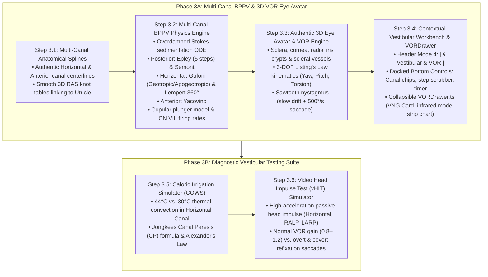

# Stage 3 Engineering Plan: Multi-Canal Vestibular Dynamics, BPPV Maneuvers & 3D VOR Eye Avatar

> **Project:** Inner Ear 3D Lab (Gate 3 Medaium)  
> **Repository:** `radiant-darwin`  
> **Status:** Detailed Implementation Blueprint (`/plan /boost`)  
> **Predecessors:**  
> - Stage 0: Pure 3D Anatomy Lab MVP — ✅ COMPLETE & VERIFIED  
> - Stage 1: Audio-Visual Tonotopy Engine & Hearing Lab — ✅ COMPLETE & VERIFIED  
> - Stage 2: Virtual Temporal Bone Radiology & SCDS Third-Window — ✅ COMPLETE & VERIFIED (`5b4c401`)  
> **Target Audience:** Medical Students, Otolaryngology (ENT) Residents, Neurotology Fellows, Neurologists, Audiologists, Physical Therapists  
> **Architectural Standard:** "Modal Workbench" Zero-Clutter Architecture (3D Stage $\ge 85\%$ Screen Area)

---

## 1. Executive Summary & Clinical Rationale

In neurotology, the vestibular labyrinth is an intricate 3D inertial measurement unit encased in the petrous temporal bone. While the auditory system (cochlea) measures acoustic vibrations, the vestibular system measures 3-axis angular acceleration (semicircular canals) and linear acceleration/gravity (otolith organs: utricle and saccule).

Dizziness and vertigo represent one of the most frequent clinical complaints in medicine, accounting for $>4\text{ million}$ emergency room and ambulatory visits annually. **Benign Paroxysmal Positional Vertigo (BPPV)** is the single most prevalent peripheral vestibular pathology, accounting for $>50\%$ of all peripheral vertigo cases.

### The Educational & Diagnostic Bottleneck
Clinicians, residents, and medical students notoriously struggle with vestibular pathology because:
1. **Canals Are Non-Cartesian and Hidden:** The three semicircular canals are oriented in oblique $45^\circ$ non-orthogonal planes (RALP and LARP pairs).
2. **Invisible Pathophysiology:** Otoconia crystals ($r \approx 5\text{–}15\text{ }\mu\text{m}$, $\text{CaCO}_3$) cannot be directly visualized in living patients.
3. **The Sensorimotor Loop (The Eye as Diagnostic Output):** Clinicians cannot diagnose the affected canal without reading the patient's **nystagmus** produced by the **Vestibulo-Ocular Reflex (VOR)**.
4. **The Torsion Blindspot:** Posterior canal BPPV causes **torsional-upbeating nystagmus**. On a featureless, generic eyeball model, cyclotorsion (rotation around the line of sight) is completely invisible. Diagnostic eye models require authentic radial iris crypts, pupillary margins, and perilimbal scleral micro-vessels to demonstrate torsional jerks clearly.

---

## 2. Stage 3 Deliverables & Phased Structure



---

## 3. Mathematical, Physical & Anatomical Foundations

All spatial calculations are anchored in the Right-Anterior-Superior (RAS) stereotaxic millimeter coordinate system:
- $+X$: Patient Right (Lateral) $\leftrightarrow$ $-X$: Patient Left (Medial)
- $+Y$: Patient Anterior (Front) $\leftrightarrow$ $-Y$: Patient Posterior (Back)
- $+Z$: Patient Superior (Cranial) $\leftrightarrow$ $-Z$: Patient Inferior (Caudal)

### 3.1 Authentic Semicircular Canal Anatomical Reference Anchors
Derived directly from authentic IE-Map v1.0.0 segmentations and Slicer fiducials (`assets/iemap/fcsv/*.fcsv`):

| Landmark ID | Anatomy | RAS Coordinates [X, Y, Z] (mm) | Clinical Target |
| :--- | :--- | :--- | :--- |
| `SSC_post_ampulla` | Posterior Canal Ampulla & Cupula | $[4.30, -1.00, -3.30]$ | BPPV Starting Reservoir, Cupula Barrier |
| `SSC_post_inf_limb` | Posterior Canal Dependent Floor | $[5.56, -2.36, -2.93]$ | Upright Gravitational Resting Point ($\phi = -84^\circ$) |
| `SSC_post_apex` | Posterior Canal Posterolateral Apex | $[8.37, -5.21, -0.40]$ | Recline Intermediate Peak ($\phi = +30^\circ$) |
| `SSC_post_sup_limb` | Posterior Canal Superior Arch | $[6.25, -4.29, +2.95]$ | Contralateral Turn Apex ($\phi = +110^\circ$) |
| `SSC_post_cc_junction` | Posterior Canal Common Crus Junction | $[4.20, -2.20, +2.00]$ | Shoulder Roll Drainage Entry ($\phi = +165^\circ$) |
| `SSC_ccrus_utricle` | Common Crus Utricular Orifice | $[4.03, -0.15, +0.10]$ | Final Reabsorption Orifice ($\phi = +186^\circ$) |
| `SSC_lat_ampulla` | Lateral (Horizontal) Canal Ampulla | $[4.20, +1.85, +0.95]$ | Horizontal Cupular Receptor, Caloric Site |
| `SSC_lat_apex` | Lateral (Horizontal) Canal Lateral Apex | $[6.85, +0.20, +0.65]$ | Lateral Most Point, Reid's $+30^\circ$ Line |
| `SSC_lat_utricle` | Lateral (Horizontal) Canal Posterior Limb | $[4.40, -0.40, +0.40]$ | Simple Non-Ampullated Utricular Orifice |
| `SSC_ant_ampulla` | Anterior (Superior) Canal Ampulla | $[4.07, +1.25, +2.20]$ | Anterior Cupular Receptor |
| `SSC_ant_apex` | Anterior (Superior) Canal Superior Apex | $[3.85, +0.45, +4.30]$ | Middle Cranial Fossa Arcuate Eminence |
| `SSC_ant_cc_junction` | Anterior Canal Common Crus Junction | $[4.20, -2.20, +2.00]$ | Shared Common Crus Inflow |
| `OticCapsuleCentroid` | Geometric Invariant Centroid ($C$) | $[4.40, +2.01, -0.31]$ | Global Rotation Anchor |

### 3.2 Canal Planes & Coplanar Push-Pull Pairs
The semicircular canals operate in three coplanar push-pull pairs:
1. **Horizontal Pair:** Right Horizontal Canal $\leftrightarrow$ Left Horizontal Canal (inclined $+30^\circ$ anterosuperiorly relative to Reid's stereotaxic baseline).
2. **RALP Pair:** Right Anterior Canal $\leftrightarrow$ Left Posterior Canal (coplanar, inclined $45^\circ$ anterolaterally relative to sagittal plane).
3. **LARP Pair:** Left Anterior Canal $\leftrightarrow$ Right Posterior Canal (coplanar, inclined $45^\circ$ posterolaterally).

### 3.3 Overdamped Stokes Sedimentation & Cupular Dynamics
Otoconia are dense calcium carbonate ($\text{CaCO}_3$, calcite) crystals:
- Particle density: $\rho_p = 2{,}710\text{ kg/m}^3$
- Endolymph density: $\rho_f = 1{,}000\text{ kg/m}^3$
- Endolymph dynamic viscosity: $\eta = 1.0 \times 10^{-3}\text{ Pa}\cdot\text{s}$ ($1.0\text{ cP}$)
- Effective hydrodynamic radius: $r_{\text{eff}} \approx 25\text{–}40\text{ }\mu\text{m}$ (rendered as enlarged $0.135\text{ mm}$ amber particles for 3D visibility).

The sedimentation velocity vector along the 3D canal centerline tangent $\mathbf{t}_{\text{canal}}$ is governed by the Stokes-Einstein equation:
$$v_{\text{sed}} = \frac{2 r^2 (\rho_p - \rho_f)}{9 \eta} (\mathbf{g}_{\text{world}} \cdot \mathbf{t}_{\text{canal}})$$
$$\mathbf{g}_{\text{world}} = \mathbf{R}_{\text{head}}^T \cdot \begin{pmatrix} 0 \\ 0 \\ -1 \end{pmatrix}$$
Where $\mathbf{R}_{\text{head}} = \mathbf{R}_x(\theta_{\text{recline}}) \cdot \mathbf{R}_z(\psi_{\text{yaw}})$ is the patient's head rotation matrix.

#### Ewald's Laws of Vestibular Function
1. **1st Law:** Eye movements occur in the plane of the stimulated canal.
2. **2nd Law (Horizontal Canal):** Ampullopetal endolymph flow (deflecting cupula toward utricle) causes **excitation** (depolarization); ampullofugal flow causes **inhibition**.
3. **3rd Law (Vertical Canals - Posterior & Anterior):** Ampullofugal endolymph flow (deflecting cupula away from utricle) causes **excitation**; ampullopetal flow causes **inhibition**.

#### Afferent Action Potential Generation
The vestibular nerve has a high spontaneous resting discharge rate ($f_{\text{baseline}} = 90\text{ spikes/s}$):
$$f_{\text{CNVIII}} = \text{clamp}\left(90 + 175 \cdot \delta_{\text{cupula}}, 10, 310\right)\text{ spikes/s}$$
- Normal Baseline: $90\text{ sp/s}$
- Maximal Excitation: $>250\text{ sp/s}$ (paroxysmal vertigo)
- Strong Inhibition: $<25\text{ sp/s}$ (hyperpolarization ceiling effect)

---

## 4. The 3D Eye Avatar & VOR Kinematics Engine

### 4.1 Eye Geometry & Structural Breakdown
The eyeball rotates around its physiological center of rotation $C_{\text{eye}}$ ($13.5\text{ mm}$ posterior to the corneal apex):
- **Globe (Sclera):** Sphere of radius $R = 12.0\text{ mm}$ ($24.0\text{ mm}$ transverse diameter).
- **Corneal Dome:** Prolate ellipsoid of radius $R = 7.8\text{ mm}$, protruding $2.5\text{ mm}$ anteriorly.
- **Iris Disc:** Diameter $12.0\text{ mm}$, recessed $2.6\text{ mm}$ behind the cornea.
- **Pupil:** Central circular aperture (diameter $2.5\text{ to }5.0\text{ mm}$).
- **High-Contrast Radial Texture:**
  - 32 procedural radial iris trabeculae & crypts.
  - Perilimbal conjunctival microvascular branching on the white sclera.
  - **Clinical Rationale:** Essential for making torsional nystagmus (cyclorotation) unmistakably visible to the naked eye.

```
                  Top Pole (12 o'clock)
                       ┌───────┐
                  ▲    │  Iris │    ▲
   Intorsion (CCW)│    │Crypts │    │ Extorsion (CW)
                  │ ┌──┴───────┴──┐ │
               ───┼─┤   Pupil     ├─┼─── Horizontal Plane
                  │ └──┬───────┬──┘ │
                  ▼    │Scleral│    ▼
                       │Vessels│
                       └───────┘
                 Bottom Pole (6 o'clock)
```

### 4.2 3-DOF Listing's Law Ocular Kinematics
Eye orientation is represented as a unit quaternion $\mathbf{q}_{\text{eye}} = (w, x, y, z)$:
$$\mathbf{R}_{\text{eye}} = \mathbf{R}_{\text{torsion}}(\phi_t) \cdot \mathbf{R}_{\text{pitch}}(\theta_v) \cdot \mathbf{R}_{\text{yaw}}(\psi_h)$$
- **Horizontal ($\psi_h$):** Adduction (medial) $\leftrightarrow$ Abduction (lateral) [Range: $-45^\circ\text{ to }+45^\circ$]
- **Vertical ($\theta_v$):** Elevation (up) $\leftrightarrow$ Depression (down) [Range: $-35^\circ\text{ to }+35^\circ$]
- **Torsional ($\phi_t$):** Intorsion (inward cyclorotation) $\leftrightarrow$ Extorsion (outward cyclorotation) [Range: $-25^\circ\text{ to }+25^\circ$]

### 4.3 3-Neuron VOR Reflex Arc & Canal-to-Muscle Coupling
Coupling matrices map endolymph cupular deflection in each canal to primary extraocular muscle innervation:

| Stimulated Canal | Primary Muscle Pair | Slow Phase Eye Velocity (Drift) | Fast Phase (Clinical Nystagmus Direction) |
| :--- | :--- | :--- | :--- |
| **Right Posterior Canal** (BPPV Dix-Hallpike) | Ipsilateral Superior Oblique (SO, CN IV) + Contralateral Inferior Rectus (IR, CN III) | Downward depression + Extorsion (Right eye), Intorsion (Left eye) | **Upbeating + Right Torsional** (top pole of right eye extorts toward affected ear) |
| **Right Horizontal Canal** (Geotropic BPPV) | Contralateral Lateral Rectus (LR, CN VI) + Ipsilateral Medial Rectus (MR, CN III) | Conjugate Leftward Yaw ($\psi_h < 0$) | **Right-Beating Horizontal** (beats toward floor/dependent ear) |
| **Right Horizontal Canal** (Apogeotropic BPPV) | Ipsilateral Lateral Rectus + Contralateral Medial Rectus | Conjugate Rightward Yaw ($\psi_h > 0$) | **Left-Beating Horizontal** (beats toward ceiling/unaffected ear) |
| **Right Anterior Canal** | Ipsilateral Superior Rectus (SR, CN III) + Contralateral Inferior Oblique (IO, CN III) | Upward elevation + Intorsion (Right eye) | **Downbeating + Right Torsional** |

### 4.4 Physiological Sawtooth Nystagmus Waveform Generator
Nystagmus is an asymmetric sawtooth oscillation combining two distinct neural mechanisms:
1. **Slow Phase (Peripheral Vestibular Drive):**
   - Velocity proportional to cupular deflection: $\dot{\mathbf{\theta}}_{\text{slow}}(t) = -G_{\text{VOR}} \cdot \mathbf{\omega}_{\text{cupula}}(t)$.
   - Peak slow-phase velocity (SPV): $2\text{ to }60^\circ/\text{s}$.
2. **Fast Phase (Central Saccadic Reset):**
   - Triggered when eye displacement exceeds retinal slip threshold ($\theta_{\text{threshold}} \approx 4.0\text{–}6.0^\circ$) or interval reaches $150\text{–}350\text{ ms}$.
   - Driven by brainstem saccade burst generators (Paramedian Pontine Reticular Formation, PPRF, for horizontal; Rostral Interstitial Nucleus of the MLF, riMLF, for vertical/torsional).
   - Ballistic velocity: $400\text{ to }700^\circ/\text{s}$, duration: $25\text{ to }40\text{ ms}$.
   - Characteristic crescendo-decrescendo amplitude profile matching particle settling dynamics.

---

## 5. Multi-Canal BPPV Protocols & Maneuver Presets

### 5.1 Protocol Matrix
Stage 3 implements 5 canonical therapeutic maneuvers and diagnostic tests:

```
┌────────────────────────────────────────────────────────────────────────────────────────┐
│ BPPV MANEUVER PRESETS & DIAGNOSTIC TESTS                                              │
├────────────────────┬─────────────────┬───────────┬─────────────────────────────────────┤
│ Maneuver Preset    │ Target Canal    │ Steps     │ Pathophysiology                     │
├────────────────────┼─────────────────┼───────────┼─────────────────────────────────────┤
│ 1. Epley Maneuver  │ Posterior Canal │ 5 Steps   │ Canalithiasis in posterior loop     │
│ 2. Semont Maneuver │ Posterior Canal │ 3 Steps   │ Rapid contralateral swing           │
│ 3. Gufoni (Geotrop)│ Horizontal      │ 3 Steps   │ Free canaliths in horizontal duct   │
│ 4. Gufoni (Apogeo) │ Horizontal      │ 4 Steps   │ Cupulolithiasis (cupula adherence)  │
│ 5. Barbecue 360°   │ Horizontal      │ 5 Steps   │ Lempert 360° axial body roll        │
│ 6. Yacovino        │ Anterior Canal  │ 4 Steps   │ Superior loop recline & chin tuck   │
└────────────────────┴─────────────────┴───────────┴─────────────────────────────────────┘
```

### 5.2 Step-by-Step Maneuver Definitions

#### A. Epley Maneuver (Posterior Canal Canalithiasis)
- **Step 1 (Start Upright):** $\psi = -45^\circ, \theta = 0^\circ \implies \phi_{\text{canal}} = -84^\circ$. Otoconia rest at posterior ampulla.
- **Step 2 (Dix-Hallpike Recline):** $\psi = -45^\circ, \theta = 120^\circ \implies \phi_{\text{canal}} = +30^\circ$. Gravity pulls otoconia toward apex. Triggers crescendo upbeating-torsional nystagmus. Hold 30–60s.
- **Step 3 (Contralateral Turn):** $\psi = +45^\circ, \theta = 120^\circ \implies \phi_{\text{canal}} = +110^\circ$. Head turns $90^\circ$ left without lifting. Otoconia roll over superior arch to common crus entry. Hold 30–60s.
- **Step 4 (Shoulder Roll):** $\psi = +135^\circ, \theta = 90^\circ \implies \phi_{\text{canal}} = +165^\circ$. Body rolls on left shoulder, nose $45^\circ$ down. Common crus points vertically downward. Otoconia drain toward utricle. Hold 30–60s.
- **Step 5 (Sit Upright):** $\psi = 0^\circ, \theta = 0^\circ \implies \phi_{\text{canal}} = +186^\circ$. Return to sitting with chin tucked. Otoconia drop into utricular vestibule. Vertigo cleared.

#### B. Gufoni Maneuver (Horizontal Canal Geotropic Variant)
- **Step 1 (Sitting):** Upright posture.
- **Step 2 (Side-Lying on Healthy Side):** Patient lies briskly onto unaffected left side ($90^\circ$ lateral roll). Hold 1–2 minutes. Otoconia slide ampullofugally toward utricle.
- **Step 3 (Nose Down 45°):** Rotate head $45^\circ$ toward the examination table. Hold 2 minutes. Otoconia fall through the non-ampullated posterior limb.
- **Step 4 (Sit Up):** Patient returns upright. Otoconia deposited safely in the utricle.

#### C. Lempert 360° Barbecue Roll (Horizontal Canal)
- **Step 1:** Supine, head rotated $90^\circ$ toward affected ear.
- **Step 2:** Head rotated face up ($0^\circ$).
- **Step 3:** Head rotated $90^\circ$ toward unaffected ear.
- **Step 4:** Patient rolls into prone position (face down, nose $45^\circ$ in bed).
- **Step 5:** Complete $360^\circ$ roll and return upright.

#### D. Yacovino Maneuver (Anterior Canal)
- **Step 1 (Upright):** Sitting upright facing forward.
- **Step 2 (Head-Hanging Supine):** Patient lies back with head extended $30^\circ$ below horizontal. Otoconia move away from anterior ampulla toward common crus. Hold 30s.
- **Step 3 (Chin-to-Chest Flexion):** Without sitting up, head is actively flexed $30^\circ$ forward (chin tucked to sternum). Hold 30s.
- **Step 4 (Sit Up):** Patient returns upright. Otoconia drain out of common crus into utricle.

---

## 6. UI/UX Architecture: The Vestibular Workbench

In strict compliance with [`docs/UI_DESIGN_SPEC.md`](file:///Users/umcai/Documents/antigravity/radiant-darwin/docs/UI_DESIGN_SPEC.md), the 3D stage commands $\ge 85\%$ of the screen.

```
┌────────────────────────────────────────────────────────────────────────────────────────┐
│ ZONE 1: TOP HEADER                                                                     │
│ [IE-MAP 3D] Inner Ear Lab    [ 🏛️ Anatomy │ 🎵 Hearing │ 🩻 Radiology │ 🌀 Vestibular ] │
├────────────────────────────────────────────────────────────────────────────────────────┤
│ ZONE 2: FULL-BLEED 3D STAGE (Three.js WebGL 60fps)                                     │
│                                                                                        │
│   ┌──────────────────────────┐             [ 3D Semicircular Canals & Ampullae ]       │
│   │ ZONE 3: FLOATING         │             [ 5 Amber Canalith Particles Along Path ]   │
│   │ INSPECTOR CARD           │             [ Cupular Deflection Glow Vector ]          │
│   │ • Afferent Spikes (sp/s) │                                                         │
│   │ • Ewald's Law Indicator  │                                ┌──────────────────────┐ │
│   │ • Patient Sensation      │                                │ ZONE 5: DOCKED       │ │
│   └──────────────────────────┘                                │ VORDrawer.ts         │ │
│                                                               │ (Bilateral 3D Eyes)  │ │
│                                                               │ [VNG Infrared Mode]  │ │
│                                                               │ [Pupil Crosshairs ⌖] │ │
│                                                               │ [SPV Nystagmogram]   │ │
│                                                               └──────────────────────┘ │
├────────────────────────────────────────────────────────────────────────────────────────┤
│ ZONE 4: CONTEXTUAL VESTIBULAR WORKBENCH DOCK                                           │
│ Protocol: [ Posterior (Epley) ] [ Horizontal (Gufoni) ] [ Barbecue 360° ] [ Yacovino ] │
│ Timeline: [▶ Play] [───●──────────────────] Step 2 of 5: Lie Back (45s) [👁️ Eyes ▾]  │
│ Quick:    [ 🕹️ Manual Head Gyro ] [ ⚡ Reset Particles ] [ ⏱️ Hold Timer: 30s ]         │
└────────────────────────────────────────────────────────────────────────────────────────┘
```

### 6.1 Top Header Mode Switcher
The header expands to 4 clean segmented buttons:
```html
<nav class="mode-switcher" role="tablist" aria-label="Lab Modes">
  <button class="mode-tab" data-mode="anatomy">🏛️ Anatomy Atlas</button>
  <button class="mode-tab" data-mode="hearing">🎵 Hearing &amp; Tonotopy</button>
  <button class="mode-tab" data-mode="radiology">🩻 Virtual Radiology</button>
  <button class="mode-tab active" data-mode="vestibular">🌀 Vestibular &amp; VOR</button>
</nav>
```

### 6.2 Contextual Bottom Dock (`AppHUD.ts`)
When in Vestibular Mode:
- **Protocol Chips:** Switch between posterior, horizontal, anterior, or diagnostic modes.
- **Step Scrubber:** Scrub continuously through maneuver steps or press `Play ▶` for animated clinical execution with automated hold countdown timers (30s / 60s).
- **Manual Head Gyro Toggle:** Toggles interactive 3-axis head rotation sliders (Yaw $\psi$, Pitch $\theta$, Roll $\phi$) to test non-standard head orientations.
- **VOR Eye Drawer Toggle:** `[ 👁️ VOR Eyes ▾ ]` opens/closes the docked VNG drawer.

### 6.3 The Docked `VORDrawer.ts` (Clinical VNG Card)
Docked in the bottom-right corner ($360\times 360$ logical, $720\times 720$ physical retina canvas), adhering to strict drawer mutual exclusivity:
- **Bilateral Eye Display:** Side-by-side left and right eyes showing conjugate/disconjugate 3D motion.
- **Realistic Iris & Sclera Texture:** High-contrast radial crypts and blood vessels guaranteeing visible cyclotorsion.
- **Infrared VNG Goggles Mode:** Toggles monochromatic infrared camera styling with:
  - Yellow pupil centroid crosshair $\oplus$.
  - White corneal reflection glint $\ast$.
  - Real-time angular degree telemetry: `H: +4.2°`, `V: +12.8° (Upbeat)`, `T: -8.5° (Right Torsion)`.
- **Live Nystagmogram Strip Chart:** Rolling multi-lead tracing plotting eye position in degrees over time, revealing the characteristic saw-tooth waveform.

---

## 7. Diagnostic Vestibular Testing Suite (Phase 3B)

### 7.1 Caloric Irrigation Simulator (COWS Rule)
- **Clinical Setup:** Patient supine with head elevated $30^\circ$ relative to horizontal, placing the horizontal canal in the vertical plane.
- **Thermal Convection:**
  - **Warm Water ($44^\circ\text{C}$):** Warms endolymph $\to$ expands $\to$ density decreases $\to$ endolymph rises $\to$ ampullopetal flow $\to$ horizontal canal excitation $\to$ nystagmus beats toward **Same** ear.
  - **Cold Water ($30^\circ\text{C}$):** Cools endolymph $\to$ contracts $\to$ density increases $\to$ endolymph sinks $\to$ ampullofugal flow $\to$ horizontal canal inhibition $\to$ nystagmus beats toward **Opposite** ear.
  - **Rule:** **C**old **O**pposite, **W**arm **S**ame (**COWS**).
- **Jongkees Canal Paresis Formula:**
  $$CP = \frac{(R_{\text{warm}} + R_{\text{cold}}) - (L_{\text{warm}} + L_{\text{cold}})}{R_{\text{warm}} + R_{\text{cold}} + L_{\text{warm}} + L_{\text{cold}}} \times 100\%$$
  - $CP > 25\%$ flags clinically significant unilateral vestibular weakness (e.g., vestibular neuritis, acoustic neuroma).

### 7.2 Video Head Impulse Test (vHIT) Simulator
- Simulates rapid, unpredictable, passive head thrusts ($10\text{–}15^\circ$ displacement, $150\text{–}250^\circ/\text{s}$ peak velocity, $>3{,}000^\circ/\text{s}^2$ acceleration) in the three coplanar canal planes:
  - **Horizontal Plane:** Right/Left lateral thrusts.
  - **RALP Plane:** Right Anterior / Left Posterior ($45^\circ$ oblique).
  - **LARP Plane:** Left Anterior / Right Posterior ($45^\circ$ oblique).
- **VOR Gain Analysis:**
  $$G = \frac{\Delta \theta_{\text{eye}}}{\Delta \theta_{\text{head}}}$$
  - Normal: $0.8\text{–}1.2$ (eye velocity perfectly compensates for head velocity, gaze stays fixed on target).
  - Pathological: $G < 0.7$ with **Overt Saccades** (catch-up saccade occurring after head movement stops) or **Covert Saccades** (catch-up saccade occurring during head rotation).

---

## 8. Detailed Step-by-Step Implementation Roadmap

```
┌────────────────────────────────────────────────────────────────────────────────────────┐
│ STAGE 3 IMPLEMENTATION PHASES & TASKS                                                  │
├────────────────────────────────────────────────────────────────────────────────────────┤
│ PHASE 3A: CORE BIOMECHANICS, MULTI-CANAL BPPV & 3D VOR EYE AVATAR                      │
│                                                                                        │
│ Task 3.1: Generate 3D Centerline Splines for Horizontal & Anterior Canals              │
│   • Parse `assets/iemap/fcsv/SSC_lat.fcsv` & `SSC_ant.fcsv`                            │
│   • Generate `horizontal_canal_path.json` (150 knots, ampulla → apex → utricle)        │
│   • Generate `anterior_canal_path.json` (150 knots, ampulla → apex → common crus)      │
│   • Validate clearance inside `ls_Hsapiens_Sl.obj` & `ls_Hsapiens_Sa.obj`              │
│                                                                                        │
│ Task 3.2: Multi-Canal BPPV Physics Engine (`web/src/physics/vestibularEngine.ts`)       │
│   • Generalize `RealtimeEpleySimulator` to `VestibularDynamicsEngine`                   │
│   • Add Epley (5 steps) & Semont (Posterior)                                           │
│   • Add Gufoni Geotropic & Apogeotropic variants (Horizontal)                          │
│   • Add Lempert 360° Barbecue Roll (Horizontal)                                        │
│   • Add Yacovino Maneuver (Anterior)                                                   │
│   • Compute cupular deflection and CN VIII afferent firing rate                        │
│                                                                                        │
│ Task 3.3: 3D Eye Avatar & VOR Kinematics Engine (`web/src/render/eyeAvatar.ts`)        │
│   • Construct bilateral 3D eyeballs with sclera, cornea, radial iris crypts, & pupil   │
│   • Implement 3-DOF Listing's Law rotation engine (Yaw, Pitch, Torsion)                │
│   • Implement asymmetric sawtooth nystagmus generator (vestibular slow drift +         │
│     PPRF/riMLF 500°/s resetting saccades)                                              │
│   • Calibrate Ewald's laws coupling matrices for all 3 canal planes                    │
│                                                                                        │
│ Task 3.4: Contextual Vestibular Workbench & VORDrawer (`web/src/ui/VORDrawer.ts`)      │
│   • Add Mode 4 [ 🌀 Vestibular & VOR ] to Header Switcher in `AppHUD.ts`               │
│   • Morph bottom dock to Vestibular Workbench (protocol chips, timeline scrubber,       │
│     step hold countdown timer, manual head gyro sliders)                               │
│   • Build docked `VORDrawer.ts` with bilateral 3D eyes, infrared VNG mode toggle,       │
│     pupil crosshairs, live degree readouts, and rolling nystagmogram strip chart       │
│   • Enforce strict drawer mutual exclusivity (Audiogram, CT, VOR, Parts)               │
│                                                                                        │
│ Task 3.5: Floating Inspector Integration & Telemetry                                   │
│   • Display cupular deflection angle, CN VIII spike rate, and Ewald law readout        │
│   • Patient sensation badge ("Calm", "Spinning Vertigo", "Cleared")                    │
│                                                                                        │
│ Task 3.6: Automated Unit & Visual Verification                                         │
│   • Build `scripts/test_vestibular_engine.js` (≥50 assertions: kinematics, Ewald, VOR) │
│   • Multi-viewport headless Chrome CDP test (`scripts/verify_mvp_cdp.js`)              │
│   • Production build clean compile (`npm run build`, 0 TypeScript errors)              │
├────────────────────────────────────────────────────────────────────────────────────────┤
│ PHASE 3B: DIAGNOSTIC TESTING SUITE (CALORIC COWS & vHIT)                               │
│                                                                                        │
│ Task 3.7: Caloric Irrigation Simulator                                                │
│   • Warm (44°C) vs. Cold (30°C) thermal convective flow in horizontal canal            │
│   • Jongkees Canal Paresis (CP) calculator with interactive input & clinical pearl     │
│                                                                                        │
│ Task 3.8: Video Head Impulse Test (vHIT) Simulator                                     │
│   • High-acceleration passive thrust across Horizontal, RALP, and LARP pairs          │
│   • Real-time VOR gain curve and overt/covert catch-up saccade simulation              │
└────────────────────────────────────────────────────────────────────────────────────────┘
```

---

## 9. Quality Assurance, Performance & Verification Criteria

1. **60fps Render Performance:**
   - Zero geometry or material allocations in the `requestAnimationFrame` loop.
   - Saccade generation uses lightweight quaternion matrix math ($<0.2\text{ ms}$ CPU frame budget).
2. **Zero-Clutter UI Guarantee:**
   - 3D stage maintains $\ge 85\%$ screen coverage across Desktop ($1440\times 900$), Tablet ($768\times 1024$), and Mobile ($390\times 844$).
   - Strict drawer exclusivity: Opening `VORDrawer` closes `CTSliceDrawer`, `AudiogramDrawer`, and `PartsDrawer`.
3. **Clinical Authenticity Assertion:**
   - Right posterior canal stimulation **must** yield upbeating and right-torsional nystagmus (top pole beats toward right ear).
   - Horizontal canal geotropic stimulation **must** yield purely horizontal nystagmus beating toward the dependent ear.
   - Caloric warm irrigation **must** yield nystagmus beating toward the same ear; cold irrigation toward the opposite ear (COWS).
4. **Automated Test Coverage:**
   - `scripts/test_vestibular_engine.js`: $\ge 50$ automated test assertions verifying canal splines, Stokes velocities, cupular angles, and VOR rotations.
   - Multi-viewport headless Chrome verification via CDP with zero console errors.
   - `cd web && npm run build` compiles with **0 TypeScript and Vite errors**.
